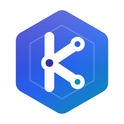
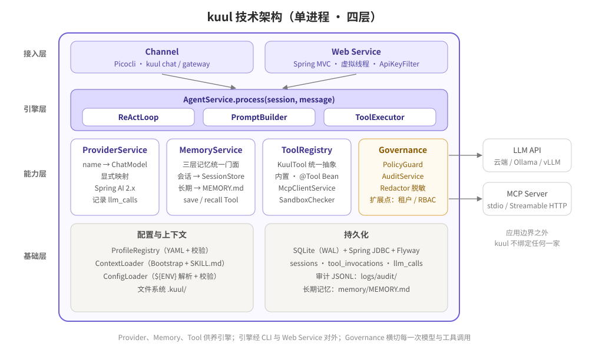
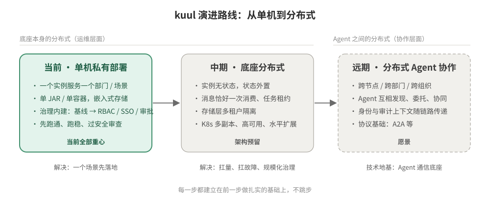

<div align="center">



# kuul

**Java 原生、私有部署、可审计的企业级 Agent OS**

让每一家企业都能在自己的边界内，像管理服务一样管理 Agent。

[](LICENSE)
[](https://openjdk.org/)
[](https://spring.io/projects/spring-boot)
[](https://docs.spring.io/spring-ai/reference/)
[](https://modelcontextprotocol.io/)
[](#项目状态)

[官网](https://likun758.github.io/kuul/) · [简介](#简介) · [特性](#特性) · [快速开始](#快速开始) · [架构](#架构) · [路线图](#路线图) · [文档](#文档) · [参与贡献](#参与贡献)

</div>

---

> [!WARNING]
> kuul 目前处于**早期阶段**：设计文档已完成，Maven 工程骨架已搭好，业务功能尚未实现。下文的 `init`、`chat`、`serve` 等用法是设计目标，不代表当前可用。欢迎在 Issue 中讨论设计。

## 简介

OpenClaw、Hermes Agent 等开源 Agent OS 在 2026 年迅速流行，但它们从个人场景起步，企业落地要靠外部加固；Java 生态有 Spring AI、LangChain4j 这样的框架，却没有一个装好就能跑的 Agent 底座。

**kuul 填补这个空白。** 它本身就是一个 Spring Boot 应用，打包成单个 JAR。多个 Agent 跑在 kuul 上，共享模型、工具、记忆、渠道和治理能力。业务方只做两件事：

- **配 Profile**：Agent 用一份 YAML 配置出来，不需要写代码；
- **写 Tool**：任何语言，通过 [MCP](https://modelcontextprotocol.io/) 接入。

消息从哪来、模型怎么调、权限怎么管、审计怎么落、上下文怎么续，都由 kuul 负责。

> 框架给的是代码，编排平台给的是流程，kuul 给的是运行时本身。

## 特性

- 🧠 **统一模型接入**：基于 Spring AI，优先支持 OpenAI 兼容协议，DeepSeek、Kimi、本地 Ollama / vLLM 开箱即用；每次调用记录 Token 用量与延迟。
- 🔁 **可控的 ReAct 引擎**：自研 Agent 循环，迭代次数、截止时间、重试策略都可配置，完整调用链可回放。
- 🧩 **三种 Tool 扩展方式**：SKILL.md + 现成 MCP Server（零代码）、自写 MCP Server（轻代码）、`@Tool` Spring Bean（重代码）。
- 📝 **跨会话记忆**：Session 持久化，重启可恢复；长期记忆存放在可读、可编辑、可 git 跟踪的 `MEMORY.md`。
- 🛡️ **治理优先**：Tool 默认拒绝、显式授权；所有模型调用和 Tool 调用都写入结构化审计；密钥不落明文。
- 📦 **装好就跑**：单个 JAR + 一个 SQLite 文件，零外部依赖；CLI、HTTP API 两种入口共享同一套引擎。
- 🔌 **兼容开放标准**：MCP、[Agent Skills](https://agentskills.io/)（SKILL.md）、OpenAI 协议，工作区格式尽量与 OpenClaw / Hermes 互通。

### 与同类项目的区别

| | OpenClaw / Hermes | Java Agent 框架 | 云托管平台 | **kuul** |
|---|---|---|---|---|
| 形态 | 常驻 Agent OS | 代码库，运行环境自己搭 | 托管服务 | 常驻 Agent OS |
| 私有部署 | ✅ | ✅ | ❌ | ✅ |
| 企业治理 | 外挂加固 | 各团队自己写 | ✅ | **内建，第一天就有** |
| 技术栈 | Node.js / Python | Java | 厂商绑定 | **Java / Spring Boot** |
| Tool 权限 | 默认宽松 | 自行实现 | 平台策略 | **默认拒绝，显式授权** |

## 快速开始

> [!NOTE]
> 以下为设计目标，代码完成后可用。

**环境要求**：JDK 21+（推荐 25 LTS）。仓库自带 Maven Wrapper，不需要单独安装 Maven。

```bash
# 构建（产物：kuul-boot/target/kuul.jar）
git clone https://github.com/likun758/kuul.git
cd kuul
./mvnw package
cp kuul-boot/target/kuul.jar .

# 初始化工作区（生成 .kuul/ 目录和默认 Profile）
java -jar kuul.jar init

# 配置模型密钥
export DEEPSEEK_API_KEY=sk-...

# 在终端里对话
java -jar kuul.jar chat

# 或者启动 HTTP 服务
export KUUL_API_KEYS=your-api-key
java -jar kuul.jar serve
```

通过 REST API 调用 Agent：

```bash
curl -X POST http://localhost:8080/api/v1/agents/default/invoke \
  -H "Authorization: Bearer your-api-key" \
  -H "Content-Type: application/json" \
  -d '{"message": "今天上海天气怎么样？"}'
```

### 配置一个 Agent

在 `.kuul/kuul.yaml` 中声明模型：

```yaml
providers:
  deepseek:
    type: openai-compatible
    base_url: https://api.deepseek.com
    api_key: ${DEEPSEEK_API_KEY}
    model: deepseek-chat
```

在 `.kuul/profiles/` 下用一份 YAML 定义 Agent：

```yaml
name: ops-assistant
identity:
  agent_name: 运维助手
  prompt_file: SOUL.md
provider:
  name: deepseek
  temperature: 0.2
tools: [read_file, http_get, shell, save_memory, recall_memory, github.*]
skills: [daily-pr-digest]
policy:
  file:
    allowed_paths: [./workspace]
  shell:
    allowed_commands: [kubectl, git]
settings:
  max_iterations: 10
  max_history_turns: 20
```

`tools` 列表就是该 Agent 的授权清单，未列出的 Tool 一律拒绝；`shell`、`write_file` 等高风险 Tool 必须逐个列出，不能用通配符授权。

### 工作区结构

```text
.kuul/
├── kuul.yaml            # Provider、沙箱、服务端口
├── mcp_servers.yaml     # 外部 MCP Server
├── AGENTS.md  SOUL.md  USER.md
├── profiles/            # 每个 Agent 一份 YAML
├── skills/<name>/SKILL.md
├── memory/MEMORY.md     # 长期记忆
├── plugins/             # @Tool Bean 的 JAR
├── data/kuul.db         # SQLite
└── logs/{app,audit}/    # 应用日志与审计日志
```

## 架构



| 层 | 组件 | 职责 |
|---|---|---|
| 接入层 | CLI Channel、Web Service | 消息进出，统一交给 `AgentService` |
| 引擎层 | `ReActLoop`、`PromptBuilder`、`ToolExecutor` | 驱动推理、组装上下文、调度 Tool |
| 能力层 | Provider、Memory、Tool、Governance | 推理、记忆、执行；治理横切每一次调用 |
| 基础层 | Profile、配置、持久化 | SQLite + Flyway，配置与记忆以文件形式存放 |

每次 Tool 调用都必须经过同一条执行管线：参数校验 → **Policy 授权** → 沙箱校验 → 执行 → **审计** → 结果回填。治理不靠调用方自觉，而是管线中的固定步骤。

**技术栈**：JDK 21+ 虚拟线程 · Spring Boot 4 · Spring AI 2.x · MCP Java SDK · Picocli · SQLite + JdbcClient + Flyway · SLF4J + Logback

## 路线图



| 阶段 | 内容 |
|---|---|
| **1.0 核心** | 五大能力（LLM、ReAct、Memory、Tool、Web Service）+ 治理基线（Tool Policy、审计、API Key、密钥外置） |
| **P0 生产准入** | SSO / RBAC / 租户、人工审批、企业微信 / 飞书 / 钉钉、防篡改审计 + SIEM、容器级沙箱 |
| **P1 规模化运营** | Skill 签名、KMS / Vault、注入防御、Provider 容灾与流式输出、配额限流、语义记忆、管理台与可观测、K8s |
| **P2 增强与扩展** | 集群高可用、情景记忆、子 Agent、MCP Server / A2A、企业系统 connector、Native Image |

演进方向：**单机 → 底座分布式 → 分布式 Agent 协作**。

### 项目状态

- [x] 产品调研、需求分析、技术方案
- [x] Maven 多模块工程骨架
- [x] 项目官网（`site/`）
- [ ] US-1 对接 LLM
- [ ] US-2 ReAct 循环 + 治理骨架
- [ ] US-3 Memory
- [ ] US-4 Tool 体系 + 完整沙箱
- [ ] US-5 Web Service + 收口
- [ ] 1.0 发布

### 不做什么

可视化 workflow 编排（Dify 等平台可以作为客户端调用 kuul）、Agent 编程框架、模型本身、SaaS 优先形态、不受审批约束的自我进化。

## 文档

项目官网：<https://likun758.github.io/kuul/>（源码在 [`site/`](site/)，VitePress 构建）。

| 文档 | 内容 |
|---|---|
| [产品调研](docs/init/ProductResearch.md) | Agent OS 是什么、业界现状、为什么是 Java、kuul 的定位 |
| [需求分析](docs/init/RequirementAnalysis.md) | 核心功能、非功能需求、验收标准 |
| [扩展分析](docs/init/ExtensionAnalysis.md) | P0 / P1 / P2 扩展功能的动因与完成标准 |
| [技术方案](docs/init/TechnicalSolution.md) | 架构、模块设计、关键技术决策 |
| [AI 编程指南](docs/init/AIProgrammingGuide.md) | 用 Spec-Kit + Claude Code 落地的方法与质量守门 |

## 参与贡献

kuul 处于早期阶段，非常欢迎参与：

- **讨论设计**：对文档有疑问或建议，欢迎提 [Issue](https://github.com/likun758/kuul/issues)。
- **贡献代码**：代码开放后，可以认领带 `good-first-issue` 标签的任务；新增内置 Tool、MCP 适配、Channel 都是很好的起点。

贡献需遵守以下约束：

- 所有 Tool 调用必须经过统一的执行管线和审计，不得绕过；
- 不得修改 `kuul-core` 的接口契约；
- 提交前对照 [CLAUDE.md](CLAUDE.md) 中的审查清单自查。

## 许可证

[Apache License 2.0](LICENSE)
