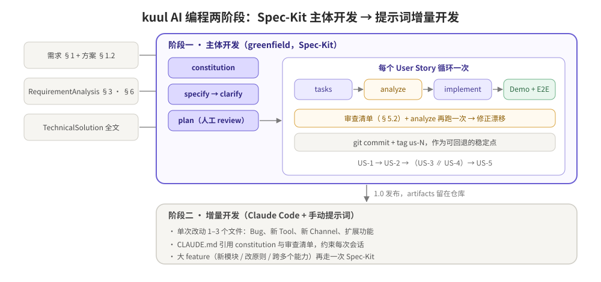
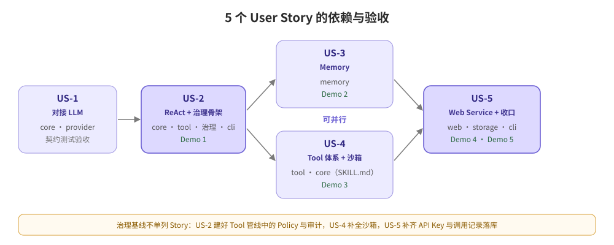

# kuul AI 编程指南

`v1.0` · `2026-11-21` · `内部讨论稿`

> 本文讲清 kuul 怎么用 AI 编程落地：拆解方法、工具切换、质量守门。不绑定时间安排，也不展开提示词细节。
>
> 前置文档：[ProductResearch.md](ProductResearch.md) · [RequirementAnalysis.md](RequirementAnalysis.md) · [TechnicalSolution.md](TechnicalSolution.md)。

**文档导航**：[产品调研](ProductResearch.md) → [需求分析](RequirementAnalysis.md) → [扩展分析](ExtensionAnalysis.md) → [技术方案](TechnicalSolution.md) → **AI 编程指南**

<b>目录</b>

- [1. 实施总览](#1-实施总览)
- [2. Spec-Kit 是否适合 kuul](#2-spec-kit-是否适合-kuul)
- [3. 准备阶段](#3-准备阶段)
- [4. User Story 拆解](#4-user-story-拆解)
- [5. 质量守门](#5-质量守门)
- [6. 增量阶段：手动提示词模式](#6-增量阶段手动提示词模式)
- [7. 交付物与风险](#7-交付物与风险)

---

## 1. 实施总览

### 1.1 两阶段，两种工具

| 阶段 | 工作性质 | 工具 | 理由 |
|---|---|---|---|
| **主体开发** | 从零搭建 10 个模块、五大能力和治理基线 | Spec-Kit + Claude Code | 大颗粒度的 greenfield 项目，需要 spec 作为契约，防止 AI 写偏 |
| **增量开发** | Bug 修复、新增 Tool / Channel、扩展功能，每次改 1–3 个文件 | Claude Code + 手动提示词 | 改动颗粒度小，跑一遍 Spec-Kit 完整流程的开销比改动本身还大 |

### 1.2 已有文档直接作为 Spec-Kit 的输入

不重写文档，而是把现有文档喂给 Spec-Kit，转换成 AI 能直接消费的 artifacts：

| Spec-Kit 步骤 | 输入 | 产出 |
|---|---|---|
| `/speckit.constitution` | 需求分析 §1（定位、治理基线、不做什么）+ 技术方案 §1.2（9 个关键决策） | `constitution.md`：不可协商的原则 |
| `/speckit.specify` | 需求分析 §3（核心功能）+ §6（5 个验收 Demo） | `spec.md`：5 个 User Story，Demo 直接作为验收标准 |
| `/speckit.clarify` | `spec.md` | 澄清结论。多数问题已经在技术方案 §1.3 决议过，这一步主要是确认 |
| `/speckit.plan` | 技术方案全文 + `spec.md` + `constitution.md` | `plan.md`：技术栈、10 个模块、数据流 |
| `/speckit.tasks` → `analyze` → `implement` | 以上全部 | 按 User Story 拆成任务，检查一致性后实施 |

**务必喂最新版文档。** 下面几点必须以最新版为准，否则生成的 plan 会走偏：

- 模块是 **10 个**，包含 `kuul-governance`；
- 版本线是 **Spring Boot 4 + Spring AI 2.x**；
- 持久化用 **JDBC + Flyway，不用 JPA**。

### 1.3 按 User Story 拆，不按时间拆

| Story | 内容 | 依赖 | 验收 |
|---|---|---|---|
| US-1 | 对接 LLM | 无 | Provider 契约测试（单独没有用户可见的 Demo） |
| US-2 | ReAct 循环 + 治理骨架 | US-1 | Demo 1：查天气写日报 |
| US-3 | Memory | US-2 | Demo 2：跨对话记住偏好 |
| US-4 | Tool 体系 + 完整沙箱 | US-2，可与 US-3 并行 | Demo 3：SKILL.md + MCP 零代码 |
| US-5 | Web Service + 收口 | US-1 至 US-4 | Demo 4：REST 会话；Demo 5：多端点联动 + 治理 |

推进顺序：**US-1 → US-2 →（US-3 ∥ US-4）→ US-5**。

- **顺序只反映依赖关系，不代表重要性。** US-5 放在最后，是因为它要等前面的能力都就绪；它恰恰是 kuul 区别于个人 Agent 的关键能力。
- **治理基线不单独拆成一个 Story**，而是随能力逐步长出来：
  - US-2 建好 Tool 管线里的 Policy 校验和审计；
  - US-4 补全沙箱；
  - US-5 补上 API Key 和调用记录落库。

  这样治理从第一个 Demo 起就存在，不会被留到最后才补。

这种拆法和 Spec-Kit 天然契合：`/speckit.tasks` 本身就按 User Story 组织任务，每个 Story 是一个独立的实施阶段，任务按依赖排好序，可以并行的会被标记出来。

---

## 2. Spec-Kit 是否适合 kuul

### 2.1 Spec-Kit 是什么

Spec-Kit 是 GitHub 开源的 spec-driven development 工具链，支持 Claude Code、Copilot、Cursor 等二十多种 AI coding agent。

它的做法是把 AI 编码组织成固定流程：specify → plan → tasks → implement。核心理念是让 spec 成为代码行为的契约和唯一事实来源，让 AI 从"代码生成器"变成"按规格干活的协作者"，以此对治 vibe coding。

| 适合 | 不适合 |
|---|---|
| 中大型 greenfield 项目，模块跨多个目录 | 小 feature、快速原型、单文件改动（流程开销大于收益） |
| 上游有明确的需求和技术决策 | 需求未定的探索性项目（会反复返工） |
| 用 AI agent 做主体开发 | 大型 brownfield 改造（遗留代码超出 LLM 上下文） |

### 2.2 匹配度

| Spec-Kit 适用的条件 | kuul 的情况 | 结论 |
|---|---|---|
| 中大型 greenfield 项目 | 全新项目，10 个 Maven 模块 | 匹配 |
| 需求清晰 | 需求分析和技术方案都已完整，未决事项也已决议 | 匹配 |
| 用 AI agent 做主体开发 | 用 Claude Code 主导开发 | 匹配 |
| 需要强制 spec-driven 流程 | 有几处容易写错的边界需要硬约束，例如 Spring AI 的使用边界、治理管线 | 匹配 |

> [!IMPORTANT]
> 社区对 Spec-Kit 的争议集中在大型 brownfield 项目上，对纯 greenfield 的 kuul 不适用。**结论：主体开发用 Spec-Kit。**

### 2.3 局限与应对

| 局限 | 应对 |
|---|---|
| 流程对小改动太重 | 只在主体开发阶段使用，增量阶段换成手动提示词（第 6 章） |
| 大型 brownfield 项目超出上下文 | 不适用：kuul 是纯 greenfield 项目，全部代码都在 LLM 的上下文窗口内 |
| spec 不会自动跟着代码同步 | 每个 Story 在 implement 前后各跑一次 `/speckit.analyze`，发现漂移立即修正 |
| 工具本身还在快速迭代：命令名、artifacts 格式、Claude Code 集成方式（已改为 skills 模式）都在变 | 开工前锁定 Specify CLI 的版本，主体开发期间不升级；具体命令以官方文档为准；不用社区扩展 |

---

## 3. 准备阶段

### 3.1 环境

- **Specify CLI**：Python 3.11+，推荐用 `uv` 安装。用 `specify init` 初始化，并指定 Claude Code 集成，具体参数以官方文档为准。
- **Java 工具链**：JDK 21+（推荐 25）、Maven；`DEEPSEEK_API_KEY`、`MOONSHOT_API_KEY` 用于真实冒烟测试。
- **AI 的知识可能过时**：模型的训练数据很可能以 Spring Boot 3 / Spring AI 1.x 为主，写 Boot 4 / Spring AI 2.x 时要给它官方文档作为上下文（例如通过文档类 MCP），并把编译错误当作"它在用旧 API"的信号。

### 3.2 constitution：kuul 项目宪章

| # | 原则 | 为什么必须写进宪章 |
|---|---|---|
| C1 | JDK 21+、Spring Boot 4、Spring AI 2.x；Maven 10 个模块；打包为单个 fat JAR | 防止 AI 退回到它更熟悉的旧版本线 |
| C2 | 范围是五大能力 + 治理基线；扩展功能不进入主体开发 | 防止 AI 顺手做了多租户、流式输出等扩展功能 |
| C3 | ReAct 循环自己实现；`kuul-core` 不依赖 Spring AI | 守住引擎可控、依赖方向正确 |
| C4 | **Spring AI 只用一半**：只用协议适配和 `@Tool` 的 Schema 生成，必须关闭内部工具执行 | AI 最容易写错的一条，写错会导致 Tool 被执行两次、绕过治理 |
| C5 | **治理不可绕过**：所有 Tool 调用都走六步管线，默认拒绝，每次调用都审计；密钥不落明文 | 这是 kuul 的差异化所在，AI 很容易给内置 Tool 开捷径 |
| C6 | Provider 用"名称 → 实例"的显式映射，禁止按 Bean 类型扫描 | 否则多个 Provider 并存时会冲突 |
| C7 | 存储用 SQLite + JDBC + Flyway + `MEMORY.md`；不用 JPA，不引入向量库 | 防止 AI 默认上 JPA 和自动建表 |
| C8 | 每个 Story 都要先有测试，结束时有可演示的 Demo 和 E2E 测试；目标是跑通，而不是完美 | 保证每一步都可以验证 |

> [!WARNING]
> 宪章写一次就锁定，**不允许 AI 自行修改**。如果发现某条原则不对，暂停开发，由人重新讨论后再改。

### 3.3 specify 与 plan

- **specify**：把需求分析转成 5 个 User Story，只描述依赖关系，不标 P1、P2 这类优先级，避免被误读成"排在后面的可以不做"。
- **plan 必须人工 review**。重点检查以下几项：
  - Memory 有没有被并进 Session（正确做法：`MemoryService` 作为统一门面）；
  - Tool 有没有被拆成多个模块（正确做法：只有 `kuul-tool` 一个）；
  - SKILL.md 有没有被当成 Tool（正确做法：由 `ContextLoader` 加载）；
  - 治理逻辑有没有散落在各个 Tool 里（正确做法：集中在 `ToolExecutor` 管线中）。

  review 通过后锁定 `plan.md`。

### 3.4 准备阶段交付物

| 交付物 | 位置 |
|---|---|
| 项目宪章 | `.specify/memory/constitution.md` |
| `spec.md`、`plan.md` | Spec-Kit 的规格目录 |
| 三份源文档 | `docs/init/` |
| `CLAUDE.md` | 仓库根目录。写明引用宪章、本文 §5.2 的审查清单，以及构建和测试命令 |

---

## 4. User Story 拆解

每个 Story 统一给出以下内容：模块、任务大类、AI 易错点、验收。易错点要写进对应任务的注意事项里。

### 4.1 US-1：对接 LLM

- **模块**：
  - `kuul-core`：领域模型，以及 `ProviderService`、`KuulTool`、`AuditSink` 等接口；
  - `kuul-provider`；
  - `kuul-governance`（`ConfigLoader`）；
  - `kuul-boot`。
- **任务大类**：
  - 搭建 10 个模块的 Maven 骨架；
  - 定义 Message、Profile 等领域模型；
  - `ProviderRegistry`：按配置直接创建 `ChatModel` 实例；
  - Spring AI 类型与 kuul 类型的双向转换；
  - `${ENV}` 占位符解析与校验；
  - `llm_calls` 记录接口。
- **易错点**：
  - 按 Bean 类型扫描 `ChatModel`（违反 C6）；
  - Spring AI 的类型渗透进 `kuul-core`（违反 C3）。
- **验收**：用 WireMock 模拟 OpenAI 兼容接口跑契约测试，真实 Key 跑通 DeepSeek 或 Kimi 中的一个。

### 4.2 US-2：ReAct 循环 + 治理骨架

- **模块**：
  - `kuul-core`：`ReActLoop`、`PromptBuilder`、`ToolExecutor`、`ContextLoader`；
  - `kuul-tool`：`http_get`，加上只校验域名的简化版 `SandboxChecker`；
  - `kuul-governance`：`PolicyGuard`、`AuditService` + `JsonlAuditSink`、`Redactor`；
  - `kuul-channel`；
  - `kuul-cli`：`init`、`chat`。
- **任务大类**：
  - **ReAct 主循环**：拆成 2–3 个子任务，分别做迭代与终止条件、消息累积、错误处理；
  - **PromptBuilder**：按注入顺序拆成子任务，逐段加入；
  - **ToolExecutor 六步管线**：先把六步骨架全部搭好，没实现的步骤用空实现占位；
  - Profile 解析与 Schema 校验；
  - 内存版 Session；
  - 会话级锁；
  - 结构化 JSON 日志，`trace_id` 放进 MDC，贯穿日志、审计和后续的调用记录。
- **测试先行**：用脚本化的模拟 Provider 覆盖以下分支：给出最终响应、调用 Tool、达到最大迭代次数、Tool 调用被拒绝。
- **易错点**：
  - 开启了 Spring AI 的自动工具执行（违反 C4）；
  - Tool 调用跳过了 `PolicyGuard` 或审计（违反 C5）；
  - 异常从循环里抛了出去。
- **验收**：Demo 1。完整调用链落到 Session，审计 JSONL 中能看到 `llm_call` 和 `tool_call` 记录。

### 4.3 US-3：Memory

- **模块**：`kuul-memory`。
- **任务大类**：
  - `MemoryService` 统一门面；
  - `LongTermMemory` 的四个方法，其中 `recall` 带 `mode` 参数；
  - `MemoryTools`：作为普通 `KuulTool` 注册；
  - 在 `PromptBuilder` 中接入。
- **易错点**：
  - `save_memory` 直接写文件，没有走 Tool 管线；
  - 给 `MEMORY.md` 加了缓存，导致写入后当轮读不到；
  - 改 `PromptBuilder` 时破坏了 US-2 已经跑通的测试。
- **验收**：Demo 2，第二次对话要在重启进程之后进行。

### 4.4 US-4：Tool 体系 + 完整沙箱

- **模块**：
  - `kuul-tool`：文件和 Shell Tool、MCP Client、`.kuul/plugins/` 加载、完整版 `SandboxChecker`；
  - `kuul-core`：`ContextLoader` 加载 SKILL.md。
- **任务大类**：
  - **MCP Client**：拆成连接管理、`tools/list`、`tools/call`、断线重连四个子任务。先做 stdio，再做 Streamable HTTP；工具名加 `<server>.` 前缀。
  - **沙箱**：拆成文件、Shell、HTTP 三个子任务，按技术方案 §6.3 加固。
  - **Profile**：支持 `github.*` 这样的通配符，并禁止用通配符授权高风险 Tool。
- **易错点**：
  - Shell 用 `bash -c` 执行；
  - 只比对命令的第一个词就放行，可以用 `;` 拼接绕过；
  - 文件路径没有解析符号链接；
  - 自动跟随了 HTTP 重定向，没有逐跳校验；
  - 把 SKILL.md 当成 Tool。
- **验收**：Demo 3，外加一组越权和绕过的负面用例，例如 `../` 路径、`ls; rm`、重定向到非白名单域名。

### 4.5 US-5：Web Service + 收口

- **模块**：
  - `kuul-web`：6 个 Controller、`ApiKeyFilter`、`GlobalExceptionHandler`；
  - `kuul-storage`：SQLite、Flyway、各类 Store；
  - `kuul-cli`：补齐全部 13 个命令；
  - `kuul-core`：Bootstrap 文件加载补全。
- **任务大类**：
  - Session 从内存版升级到 SQLite，并支持跨重启恢复；
  - `tool_invocations` 和 `llm_calls` 落库；
  - 单写线程 + WAL；
  - 空闲 Session 定时归档；
  - 10 个端点：6 个 Controller 之间互不依赖，可以并行实现。
- **易错点**：
  - 调用记录只写日志、不落库；
  - 用 `ddl-auto` 自动建表；
  - 比较 API Key 时没有用常量时间比较；
  - Session 迁移到 SQLite 时丢失了 `tool_calls`。
- **验收**：
  - Demo 4、Demo 5；
  - 需求分析第 5 章的性能压测；
  - 可运维验收：新手 30 分钟内完成单节点部署，CLI 的帮助和错误提示清晰。

  全部通过后跑最后一次 `analyze`，主体开发完成。

---

## 5. 质量守门

### 5.1 每个 Story 的固定流程

1. 开工前：让 AI 重读 `spec.md`、`plan.md` 和最近的代码，避免跨 Story 丢失上下文。同一个 Story 内，如果 AI 不清楚前面的任务做了什么，也照此处理。任务颗粒度保持在每个 task 改 1–2 个文件。
2. 跑 `tasks`，再跑 `analyze`，然后 `implement`。
3. 先写测试，再写实现，测试全部变绿。
4. 用 §5.2 的审查清单做人工检查，再跑一次 `analyze`。
5. 跑 Demo 和 E2E 测试。
6. `git commit` 并打 tag `us-N`，作为可回退的稳定点。

### 5.2 审查清单（AI 最容易写错的地方）

| 检查项 | 违反的原则 |
|---|---|
| 是否关闭了 Spring AI 的内部工具执行 | C4 |
| Provider 是否按名称显式映射 | C6 |
| `kuul-core` 中是否出现了 Spring AI 的 import | C3 |
| 每条 Tool 调用路径是否都经过 `PolicyGuard` 和审计 | C5 |
| 高风险 Tool 是否可能通过通配符被授权 | C5 |
| Shell、文件、HTTP 的沙箱加固是否完整 | C5 |
| 是否出现了 JPA、`ddl-auto` 或向量库依赖 | C7 |
| 调用记录是否真的落库 | C5 |
| SKILL.md 是否被当成了 Tool | 技术方案 §6.2 |

> [!TIP]
> 发现偏离时，让 AI 重读宪章后修正，而不是人工直接替它改。这样它在后续任务中更不容易重犯。

---

## 6. 增量阶段：手动提示词模式

### 6.1 工作流

1. 认领 issue，标签有 `good-first-issue`、`feature-request`、`long-term-goal` 三类；
2. fork 并 clone 仓库，用 Claude Code 打开；Claude Code 会自动读取 `CLAUDE.md`，宪章和审查清单随之进入上下文；
3. 描述要做的改动，让 AI 在现有代码上修改并补测试；
4. 本地测试全部通过后提 PR；
5. 项目方按审查清单 review 后合并。

### 6.2 何时重新走 Spec-Kit

| 改动 | 方式 |
|---|---|
| Bug 修复、新增内置 Tool 或 MCP 适配、补端点 | 手动提示词 + PR |
| 新增 Maven 模块、修改宪章、跨多个能力的功能（如多租户、IM 渠道） | 由项目方决定是否重新跑一次 `specify → plan → tasks` |

主体阶段的 artifacts 会长期保留在仓库中，各自的角色如下：

- **`constitution.md`**：继续作为不可协商的原则；
- **`spec.md`**：作为验收契约，改动不能破坏其中的验收标准；
- **`plan.md`**：不再更新，以技术方案为准。

---

## 7. 交付物与风险

### 7.1 主体开发交付物

- **kuul 1.0**：五大能力和治理基线全部跑通，5 个 Demo 全部通过；
- **项目主页**：放在 `site/` 目录，用 VitePress 构建；
- **Spec-Kit artifacts 与 `CLAUDE.md`**：保留在仓库中，供后续社区贡献时参考；
- **其余文档**：API 参考、运维手册、贡献指南由社区通过 PR 共建。

### 7.2 风险

| 风险 | 应对 |
|---|---|
| AI 偏离宪章 | §5.2 审查清单 + 每个 Story 两次 `analyze`，作为硬性环节不可省略 |
| AI 用旧版 API 写新版框架 | 宪章写明版本线；提供官方文档作为上下文；把编译错误当作需要纠正的信号 |
| 跨 Story 上下文断裂 | 每个 Story 开工前重读 spec、plan 和最近的代码 |
| MCP stdio 踩坑：进程启动失败、编码问题、stderr 混入输出 | US-4 开始前先用一个最小的 MCP Server 验证连通性 |
| Spec-Kit 版本变化 | 锁定版本，以官方文档为准 |
| 团队不熟悉 Spring Boot 和 Maven | 开工前补齐基础；AI 能写代码，但人得能看懂并审查 |
