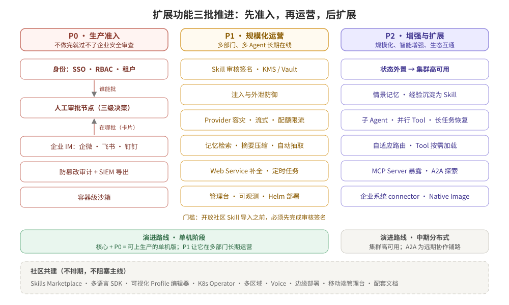

# kuul 扩展功能分析

`v1.0` · `2026-11-22` · `内部讨论稿`

> 本文单独分析核心阶段之后的扩展功能。每项都回答四个问题：为什么要做、为什么排在这个优先级、依赖什么、做到什么程度算完成。
> - 核心功能见 [RequirementAnalysis.md](RequirementAnalysis.md)。
> - 为扩展预留的技术位置见 [TechnicalSolution.md](TechnicalSolution.md) §13.3。

**文档导航**：[产品调研](ProductResearch.md) → [需求分析](RequirementAnalysis.md) → **扩展分析** → [技术方案](TechnicalSolution.md) → [AI 编程指南](AIProgrammingGuide.md)

<b>目录</b>

- [1. 定位与排序原则](#1-定位与排序原则)
- [2. P0：生产准入](#2-p0生产准入)
- [3. P1：规模化运营](#3-p1规模化运营)
- [4. P2：增强与扩展](#4-p2增强与扩展)
- [5. 社区共建](#5-社区共建)
- [6. 风险](#6-风险)

---

## 1. 定位与排序原则

> [!IMPORTANT]
> 核心阶段交付的是**运行时内核加治理基线**，能让企业试点，但还上不了生产。扩展阶段负责补齐两件事：
>
> - **企业治理层**：kuul 区别于 OpenClaw / Hermes 的差异化所在；
> - **生产化能力**：让 kuul 能在多个部门长期稳定运营。

| 优先级 | 判定标准 | 一句话 |
|---|---|---|
| **P0 生产准入** | 满足以下任一条：监管硬要求、企业安全审查的必过项、核心阶段明确声明"不适合生产"的缺口 | 不做完就过不了企业安全审查 |
| **P1 规模化运营** | 多部门、多 Agent 长期在线后，必然出现的成本、稳定性、易用性问题 | 能上线之后，要让它好用、省钱、稳定 |
| **P2 增强与扩展** | 提升智能水平、扩大规模、与外部生态互通；不做也不影响生产使用 | 锦上添花，或为中远期演进铺路 |
| **社区** | 不在主线上，有人贡献就推进 | 不排期，不阻塞主线 |

**与演进路线的对应**：

- **单机阶段**：核心 + P0 构成可上生产的单机版，P1 让它在多部门长期运营。也就是说，调研文档里"单机做扎实"的内容，覆盖核心、P0 和 P1。
- **中期分布式**：对应 P2 中的状态外置和集群高可用。
- **远期 Agent 协作**：以 P2 中的 A2A 探索为起点。

---

## 2. P0：生产准入

| 功能 | 为什么需要 | 依赖与预留 | 完成标准 |
|---|---|---|---|
| **身份与权限**：SSO（OIDC / SAML）、RBAC（细到 Agent / Tool / Skill）、单级租户 | 企业要求"谁能用哪个 Agent、调哪个 Tool"必须可控，统一身份是安全审查的第一项；后续的审批和审计也都需要"谁"这个信息 | 把 `ApiKeyFilter` 替换为 Spring Security；`tenant_id` 字段已预留；API 鉴权升级为 JWT | 用企业 IdP（Keycloak / Entra ID / Okta）登录；越权访问 Agent 或 Tool 返回 403 并写入审计；不同租户的 Session、Memory、审计数据互相不可见 |
| **人工审批节点** | 国内智能体实施意见要求三级决策权限（保留给用户 / 需用户批准 / 可自主执行）；让高风险动作"先批后做"是 kuul 区别于个人 Agent 的关键 | 在 Tool 管线的 b 步和 d 步之间插入 `ApprovalGate`；**依赖身份**（谁有权审批）和**审批入口**（IM 卡片或 REST） | 可以给 Tool 配置三档决策级别；需审批的调用先挂起，批准后继续执行，拒绝或超时则回传给 LLM；全过程留痕 |
| **企业 IM 渠道**：企业微信、飞书、钉钉 | 最终用户在 IM 里工作；审批卡片也需要 IM 作为载体；企业落地的头号障碍就是集成（46%） | 实现 `Channel` 接口，复用 `AgentService` | 三个渠道都支持收发文本、卡片消息和审批回调；用户身份映射到企业账号；单条消息时延 P99 < 1 秒（不含 LLM 耗时） |
| **防篡改审计 + SIEM 导出** | 等保、金融行业要求审计留痕不可篡改，并纳入企业现有的 SIEM 体系 | 新增 `AuditSink` 实现；审计 JSONL 加链式哈希 | 篡改任意一条记录都能被校验工具发现；支持 Syslog / HTTP 方式推送到 SIEM；审计记录可按 `trace_id` 和用户查询 |
| **容器级沙箱** | 核心阶段的应用层白名单不是真正的隔离，也是"不适合高敏感生产场景"声明的根源 | 新增 `ToolRunner` 接口，从进程内执行切换为容器执行 | Shell 和文件类 Tool 在 rootless 容器中执行，有资源配额、网络策略、只读根文件系统；容器逃逸测试通过 |

> [!TIP]
> **P0 内部的推进顺序**：先做身份，再做审批。IM 渠道和审批可以并行推进，但审批要在 IM 卡片可用之后才算完整。审计和沙箱相互独立，随时可以并行。

---

## 3. P1：规模化运营

| 功能 | 为什么需要 | 依赖与预留 | 完成标准 |
|---|---|---|---|
| **Skill / Tool 来源治理**：注册、审核、签名、版本管理 | OpenClaw 的头号安全问题就出在技能供应链上（ClawHavoc 事件）。**这是一道门槛：开放社区 Skill 导入之前必须先完成** | 依赖身份（审核人是谁） | 未签名的 Skill 拒绝加载；可以按版本回滚；能追溯每个 Skill 的来源 |
| **凭证托管**：KMS / Vault | 环境变量方式难以轮转和审计，凭证收割是个人 Agent 的高发问题 | 扩展 `ConfigLoader` 的取值来源 | 密钥支持动态获取和定期轮转，配置文件中不出现任何明文 |
| **注入与外泄防御** | 工具投毒的攻击成功率最高达 72.8%（MCPTox） | Tool 输出已有分隔标记，在此基础上增强 | 记忆写入和 Tool 输入经过扫描；外发目标受控；红队用例集通过率达标 |
| **Provider 容灾 · 流式输出 · 配额限流** | 单一模型服务故障会导致业务中断；IM 场景需要流式输出改善体验；Gartner 预测 40% 的 Agentic 项目会因成本失控等原因被取消 | `provider.fallback` 字段已预留；`AgentService` 改为事件流 | 主 Provider 故障时自动切换，业务无感知；支持 SSE；可以按租户 / Agent 设置 Token 配额，超额后拒绝调用并告警；有成本看板 |
| **记忆增强**：语义检索、摘要压缩、自动抽取 | 合规知识助手这类场景依赖检索准确度；长对话不能只靠截断 | `recall(mode)` 已预留；在 pgvector / JVector 中二选一 | 检索准确率在评测集上达标；长对话压缩后关键事实不丢失 |
| **Web Service 补全 · 定时任务** | 补齐 Profile / Memory 的增删改、调用历史、Webhook、OpenAPI 文档；"每天早上推送"这类场景需要定时触发 | 按 Web Service 的现有约定扩展 | 新增 15 个端点；可以按 cron 表达式或心跳周期触发 Agent；Webhook 支持签名校验 |
| **Web 管理台 · 可观测 · K8s 部署** | 非工程师需要界面来管理 Agent、Session 和审计；需要接入企业现有的监控体系；需求里写明"Kubernetes 在扩展阶段" | Micrometer、OpenTelemetry 复用 `trace_id`；Helm Chart | 管理台覆盖 Profile、Session、审计、审批四类视图；提供 Grafana 模板；`helm install` 一条命令完成部署 |
| **渠道补充**：Slack、邮件、Web 嵌入组件 | 外企和跨境团队有需求；门户网站需要嵌入对话框 | 实现 `Channel` 接口 | 与 P0 IM 渠道的验收标准相同 |
| **三级组织模型**：组织 / 部门 / 项目 | 集团型企业需要分层授权 | 在 P0 的单级租户上扩展 | 权限按层级继承；部门之间数据隔离 |

---

## 4. P2：增强与扩展

| 功能 | 为什么需要 | 为什么排在 P2 |
|---|---|---|
| **状态外置 → 集群高可用** | 服务全公司时要扛量、扛故障 | 单机版能在部门级跑稳就够用；集群依赖 Redis / PostgreSQL 等外部组件，部署复杂度明显上升 |
| **情景记忆 · 经验沉淀为 Skill**（需审批） | 实现"越用越聪明"，把资深员工的经验沉淀为企业资产 | 依赖记忆增强和 Skill 签名；自我进化必须受审批约束 |
| **子 Agent 委托 · 并行 Tool · 长任务中断恢复** | 复杂任务需要拆分；长任务需要持久化执行 | 先保证单 Agent 链路稳定；kuul 不做编排，只提供必要的运行时原语 |
| **自适应模型路由 · Tool 按需加载** | 进一步降成本；工具数量多时节省上下文 | 依赖 P1 的成本数据和调用质量数据积累 |
| **kuul 作为 MCP Server · A2A 探索** | 让外部系统和其他 Agent 能调用 kuul 上的 Agent；为远期跨节点协作铺路 | 协议仍在演进；身份和审计链要能跨系统传递，这个前提还不成熟 |
| **企业系统 connector**：ERP / CRM / CMDB | 集成是企业落地的头号障碍 | 通过 MCP 已经可以接入；项目方只提供 connector 规范和 1–2 个参考实现，长尾留给社区 |
| **GraalVM Native Image** | 缩短启动时间、降低内存占用，接近 Node 的体验 | Spring AI 的 AOT 适配有额外成本；对常驻服务而言，2–4 秒的启动时间可以接受 |
| **配置热更新** | 修改 Profile 后不用重启 | P1 已有 reload 端点可以手动触发，自动热更新只是体验提升 |

---

## 5. 社区共建

| 方向 | 说明 |
|---|---|
| Skills Marketplace | 必须建立在 P1 的 Skill 签名之上，否则会重蹈 ClawHub 的覆辙 |
| 多语言 SDK | 优先顺序：Java → Python → TypeScript → Go |
| 可视化 Profile 编辑器 | 输出标准 Profile YAML，让非工程师也能配置 Agent |
| K8s Operator · 多区域部署 | 在 P1 Helm Chart 和 P2 集群能力的基础上做 |
| Voice Channel · 移动端管理台 · 边缘部署 | 场景型扩展，适合社区贡献者入门 |
| 配套文档 | API 参考、运维手册、贡献指南 |

> [!WARNING]
> **社区贡献的准入条件**：遵守项目宪章（见 [AIProgrammingGuide.md](AIProgrammingGuide.md) §3.2）；不得绕过 Tool 管线和审计；不得修改 `kuul-core` 的接口契约。

---

## 6. 风险

| 风险 | 应对 |
|---|---|
| **P0 工作量大，社区接力不确定** | 项目方保底投入全部 P0；P1 优先做 Skill 签名和配额限流 |
| **多租户改造牵动全局** | `tenant_id` 从核心阶段起就已存在于 Session 和审计中；先做单级租户，再扩展为三级 |
| **审批拖慢 Agent 体验** | 只对高风险 Tool 启用审批；审批超时可配置；低风险动作默认自主执行 |
| **社区 Skill 带来供应链风险** | 硬门槛：Skill 签名完成之前，不开放社区 Skill 导入 |
| **扩展功能侵蚀"不做编排"的边界** | 子 Agent、定时任务只作为运行时原语提供，不做可视化编排 |
