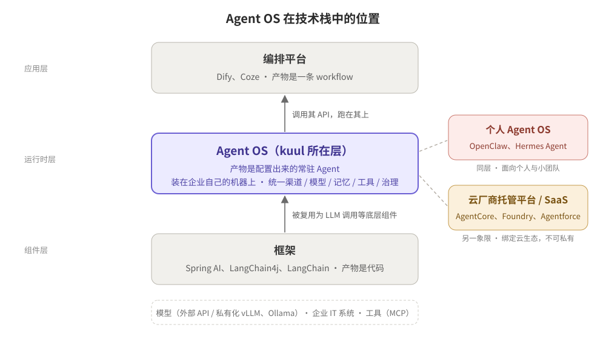
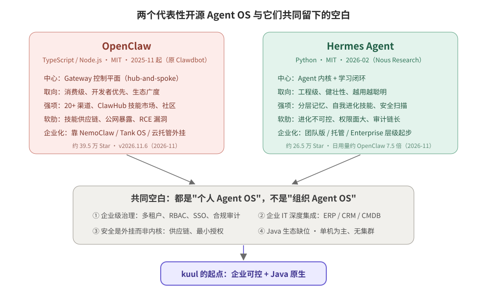
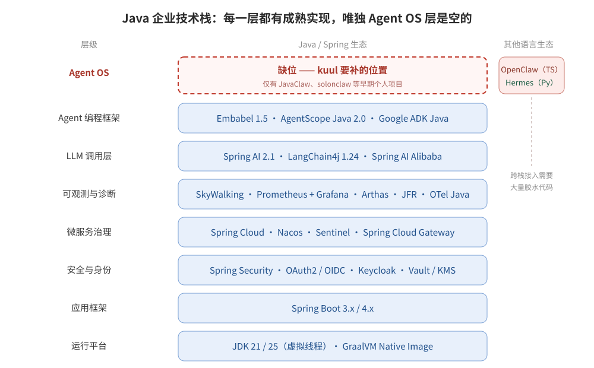
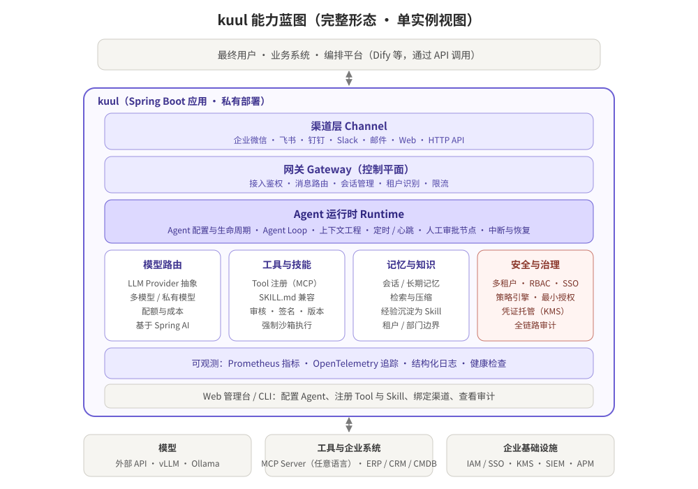
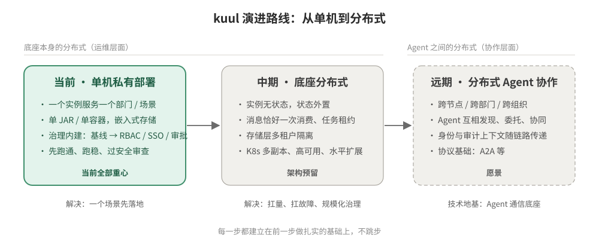

# kuul 产品调研：Java 原生的企业级 Agent OS

`v1.2` · `2026-11-21` · `内部讨论稿`

> 本文回答三个问题：
> 1. 业界在 Agent OS 上已经做了什么；
> 2. 为什么 Java 生态还没有人做；
> 3. kuul 要把它做成什么样子。
>
> 社区 Star 数、安全事件等数据变化很快，文中数字都截至 2026-11-21，只用来判断量级和趋势。

**文档导航**：**产品调研** → [需求分析](RequirementAnalysis.md) → [扩展分析](ExtensionAnalysis.md) → [技术方案](TechnicalSolution.md) → [AI 编程指南](AIProgrammingGuide.md)

<b>目录</b>

- [摘要](#摘要)
- [1. 什么是 Agent OS](#1-什么是-agent-os)
- [2. 业界代表项目](#2-业界代表项目)
- [3. 企业为什么需要私有可控的 Agent 底座](#3-企业为什么需要私有可控的-agent-底座)
- [4. Java 生态的位置](#4-java-生态的位置)
- [5. kuul 的定位](#5-kuul-的定位)
- [6. 演进方向](#6-演进方向)
- [附录：主要参考资料](#附录主要参考资料)

---

## 摘要

- **Agent OS 是运行和管理 AI Agent 的底座**。runtime 只负责让一个 Agent 跑起来，Agent OS 负责让一群 Agent 在企业里被管起来。
- **开源 Agent OS 在 2026 年爆发**，代表项目有两个，都从个人和小团队场景起步：
  - OpenClaw（Node.js，约 39.5 万 Star），生态最广；
  - Hermes Agent（Python，约 26.5 万 Star），在 OpenRouter 上的用量约为 OpenClaw 的 7.5 倍。
- **企业的刚需是一个私有、可控、可审计的 Agent 底座**，不在于"Agent OS"这个品类本身。企业落地的主要障碍是集成和治理，不是模型能力。
- **Java 生态有框架，没有底座**。62% 的企业已经在用 Java 构建 AI 功能，但目前没有一个 Java 写的、装好就能跑的企业级 Agent OS。
- **kuul 的定位**：
  - 继承 OpenClaw / Hermes 已经验证过的产品形态；
  - 把企业治理作为 day one 设计；
  - 只做运行时这一层，不做编排；
  - 演进路线是：单机 → 底座分布式 → 分布式 Agent 协作。

---

## 1. 什么是 Agent OS

### 1.1 定义

**Agent OS 是装在企业自己机器上的 Agent 底座。** 它向上为运维、客服、销售等各类 Agent 提供统一的运行环境，向下接入模型、渠道、工具、记忆、身份和审计。

一个合格的 Agent OS 要具备五项能力：

| 能力 | 说明 |
|---|---|
| Agent 配置与生命周期 | 注册、启动、监控、销毁多个 Agent。Agent 是配置出来的，不需要写代码 |
| 统一对外渠道 | IM、邮件、Web、HTTP API，所有 Agent 共用 |
| 统一对内接入 | LLM、MCP 工具、企业 IT 系统、知识库，所有 Agent 共用 |
| 统一记忆 | 跨会话的长期记忆、可复用的 Skill、跨 Agent 的知识沉淀 |
| 工具调用与沙箱 | 通过 Function Calling 调用 Tool，Tool 在隔离环境中执行 |

业务方只做两件事：用任何语言写 Tool（通过 MCP 暴露），在底座上配置 Agent。消息从哪来、模型怎么调、身份怎么管、审计怎么落、上下文怎么续，都由底座负责。Agent 也可以由定时任务或事件触发，自主运行。

**Agent OS 和 agent runtime 不是一回事。** runtime 是单个 Agent 的执行内核，相当于上表的最后一项。Agent OS 包含 runtime，在它之上再加多 Agent 管理、统一接入、多租户和审计。打个比方：runtime 是进程，Agent OS 是操作系统。

### 1.2 概念来源

| 流派 | 代表 | 核心观点 |
|---|---|---|
| 比喻派 | Karpathy "LLM OS"；*LLM as OS, Agents as Apps* | LLM 是内核，上下文是内存，工具是外设 |
| 系统派 | MemGPT / Letta；AIOS（COLM 2025） | 在 LLM 外面实现调度、分级记忆、权限等 OS 机制 |
| 产品派 | OpenClaw、Hermes Agent | 常驻运行、多渠道、可装技能、有长期记忆，**kuul 直接对标这一派** |
| 平台派 | Bedrock AgentCore、Azure Foundry、Vertex AI Agent Engine | 企业级能力完整，但绑定云厂商 |

> [!IMPORTANT]
> 业界的共识是：**LLM 是不可完全信任的计算资源，真正承担内核职责的，是一层确定性的运行时。**

### 1.3 与相邻概念的区别

| 类别 | 代表 | 产物 | 与 Agent OS 的关系 |
|---|---|---|---|
| 编排平台 | Dify、Coze | 一条 workflow | 跑在 Agent OS 之上 |
| Agent 框架 | Spring AI、LangChain4j | 代码，运行环境自己搭 | 作为 Agent OS 的底层组件 |
| 云托管平台 | Bedrock AgentCore、Agentforce | 托管服务 | 不同象限，无法私有部署 |
| 个人 Agent OS | OpenClaw、Hermes | 常驻 Agent | 同层同类，服务对象和治理深度不同 |

---

## 2. 业界代表项目

### 2.1 OpenClaw：消费级，生态优先

| 维度 | 信息 |
|---|---|
| 背景 | 2025 年 11 月由 Peter Steinberger 发布，Node.js 实现，MIT 协议。2026 年 7 月起由 OpenClaw Foundation（501(c)(3)）治理 |
| 规模 | 约 39.5 万 Star。春季以后增长放缓，ClawHub 技能超过 1 万个，最新版本 v2026.11.6 |
| 架构 | 以网关为中心的星型控制平面，统一 WebSocket 接入；会话用 JSONL 存储，并自动压缩；工作区文件（`AGENTS.md`、`SOUL.md`、`MEMORY.md`）注入上下文；支持 cron / 心跳 |
| 贡献 | 定义了个人 Agent OS 的产品形态，衍生实现超过 50 个；推动 SKILL.md 走向开放标准 |

**企业落地问题是结构性的：**

- **恶意技能**：ClawHavoc 事件中确认的恶意技能有 824 个以上，各机构口径不同。
- **公网暴露**：一度有 13.5 万多个实例暴露在公网。
- **漏洞**：远程代码执行漏洞 CVE-2026-25253，以及反复出现的凭证收割问题。
- **加固方案都是外挂**：企业要用只能靠外部加固，例如 NVIDIA NemoClaw、Red Hat 工程师的 Tank OS，或者交给云厂商托管（腾讯云 ClawPro、阿里云、百度）。
- **国内信号不一**：2026 年初 OpenClaw 在国内掀起"养龙虾"热潮，但主管部门要求国企办公终端限制使用。

### 2.2 Hermes Agent：工程级，健壮性优先

| 维度 | 信息 |
|---|---|
| 背景 | Nous Research 于 2026 年 2 月发布，Python 实现，MIT 协议 |
| 规模 | 约 26.5 万 Star，最新版本 v0.23.3。2026 年 5 月起在 OpenRouter 上的 Token 用量反超 OpenClaw，11 月时为 1.9T 对 251B |
| 架构 | 以 Agent 内核和学习闭环为中心：技能自动生成并自我修补（GEPA）；三层记忆（会话、用户画像、FTS5 检索）；记忆写入和工具输入都做注入检测；可从 OpenClaw 一键迁移 |
| 企业化 | 推出了团队版和私有化 Enterprise 层级，但公开资料有限 |

**风险**：

- **权限面大，"爆炸半径"大**：已披露 CVE-2026-7113 等漏洞。
- **自我进化可能演化出不安全行为**：见论文 arXiv:2608.12851。这与企业的变更管理天然冲突。

### 2.3 共同空白

| 维度 | OpenClaw | Hermes Agent |
|---|---|---|
| 设计中心 | 网关 | Agent 内核 |
| 技能来源 | 人工编写，市场分发 | 自动生成，自我修补 |
| 企业化路径 | 外部加固 + 云托管 | 官方企业版 |
| 主要风险 | 技能供应链、公网暴露 | 进化失控、权限面大 |

两个项目共同留下五个空白：

1. 没有完整的企业治理：多租户 RBAC、SSO、审计、合规留证；
2. 安全是外挂的，不是内核能力：缺少技能签名、权限声明、最小授权和凭证托管；
3. 企业 IT 系统（ERP、CRM、CMDB）需要各家自己适配；
4. 以单机为主，缺少集群和高可用；
5. Java 生态缺位。

---

## 3. 企业为什么需要私有可控的 Agent 底座

### 3.1 需求真实，难在可控落地

**需求侧的数据：**

- Anthropic《2026 State of AI Agents》：超过半数企业已经部署多步骤 Agent，80% 报告获得了可衡量的回报；
- KPMG：2026 年第三季度，美国企业的 Agent 部署率达到 30%。

**落地侧的数据：**

- Gartner 预测：到 2027 年，超过 40% 的 Agentic AI 项目会被取消；
- 企业最大的三个障碍是集成（46%）、数据质量（42%）、变更管理（39%）；
- 工具投毒攻击成功率最高达 72.8%（MCPTox）；
- 员工私自部署的"影子 Agent"游离在 IT 治理之外。

> [!IMPORTANT]
> **结论：这些问题没有一个能靠更强的模型解决，都要靠更稳、更可控的底座。**

### 3.2 严监管企业的刚需

银行、政府、电信、能源、医疗这类企业有四条铁律：

1. 数据不出企业；
2. 系统完全可审计；
3. 新组件要过安全合规流程；
4. 技术栈要与现有体系对齐。

监管还在收紧：

- **中国**：2026 年 5 月发布的智能体实施意见要求三级决策权限，人工审批、权限分级和行为留痕成为硬要求；
- **欧盟**：AI Act 的透明度义务自 2026 年 8 月起适用。

现有选项都满足不了这些企业：

| 选项 | 问题 |
|---|---|
| SaaS / 云托管 | 数据出企业，锁定生态 |
| 直接用 OpenClaw / Hermes | 有安全事件史，默认权限宽松，技术栈不对齐 |
| 用框架自己写 | 每个团队都要重复造权限、审计、隔离的轮子，标准还不统一 |

企业需要的是**统一的底座**，不是各写各的框架代码：模型接入与配额、身份权限、工具治理、审计都应该统一。这和当年从各写各的线程池走向统一应用服务器、走向 Kubernetes 是同一个逻辑。这个需求锚定在企业的本质约束上，不会因为技术概念的变化而消失。

最深的价值是**知识沉淀**：通过 Skill 把资深员工的经验变成企业资产，并留在企业内部。

---

## 4. Java 生态的位置

### 4.1 现状：有框架，没底座

| 层次 | 项目 | 现状 |
|---|---|---|
| LLM 调用 | Spring AI | 2.0 于 2026 年 6 月 GA（面向 Spring Boot 4），最新 v2.1.0，约 9.7k Star |
| | Spring AI Alibaba | 提供十余个国产模型的 connector，最新 v1.1.2.2，Agent 能力的重心正在转向 AgentScope，约 11.2k Star |
| | LangChain4j | 最新 1.24.0，约 13.4k Star |
| Agent 框架 | Embabel、AgentScope Java、Google ADK Java | 2026 年集中成熟（Embabel 1.x，AgentScope Java 2.0 GA） |
| **Agent OS 底座** | JavaClaw、solonclaw | 个人项目级别，Star 从几十到几百 |

Java 的 AI 社区在"写 Agent"这一层已经成形，但"跑 Agent"这一层几乎是空的。对比一下量级：Java 最大的 AI 框架约 1.3 万 Star，而 OpenClaw 约 39.5 万。

### 4.2 为什么还没人做成

1. **框架惯性**：Java 生态习惯"把库加进应用"的模式，库天然不负责常驻运行和多 Agent 治理。
2. **时间窗口很新**：这波浪潮起于个人场景，主流语言是 TS 和 Python。企业需求是在 2026 年上半年个人 Agent 安全问题集中暴露之后才清晰起来的。
3. **大厂选择做云托管**：开源部分仍然定位为框架。
4. **现有 Java 版 Claw 停在移植层面**：只是复刻 OpenClaw，没有以企业治理为原点重新设计。

### 4.3 Java 的支点

| 支点 | 说明 |
|---|---|
| 部署即标准 | kuul 就是一个 Spring Boot 应用，IT 部门不需要学新东西 |
| LLM 接入复用 | 直接用 Spring AI / Spring AI Alibaba |
| 运维工具链复用 | Nacos、Sentinel、SkyWalking、Arthas、Prometheus |
| 系统对接成本低 | Tool 可以直接调用企业现有的 Java 服务，不需要跨语言胶水 |
| 安全与合规现成 | Spring Security、OIDC、Vault，以及企业现有的代码审计和 SBOM 流程 |
| 性能短板可补 | 虚拟线程适合高并发网关；GraalVM Native Image 能接近 Node 的启动速度，但 AOT 适配有额外成本 |

技术栈演化的顺序很清楚：LLM 调用层和 Agent 框架层都已经就位，**下一个要补的就是 Agent OS 底座**。

---

## 5. kuul 的定位

### 5.1 定义

> [!IMPORTANT]
> **kuul 是一个企业能完全掌控的、Java 原生的、私有可审计的 Agent 统一底座。**

| 关键词 | 含义 |
|---|---|
| 完全掌控 | Apache 2.0 开源，私有部署，可接本地模型，数据不出边界 |
| Java 原生 | 就是一个 Spring Boot 应用，复用企业现有的中间件和运维体系 |
| 私有可审计 | 模型调用、工具调用、数据访问全部结构化留痕，记录防篡改 |
| 统一底座 | 多个 Agent 共享渠道、模型、记忆、工具和治理能力 |

kuul 锚定的是**严监管企业对可控 Agent 底座的刚需**，不是"Agent OS"这个概念。概念可能会变，这个需求不会变。

### 5.2 设计原则

1. **治理优先**：身份、权限、审计、隔离都是内核能力，第一天就具备。
2. **默认最小授权**：能力必须显式授予，默认拒绝。
3. **一切可审计**：关键动作写入结构化审计日志，记录防篡改，可对接 SIEM。
4. **确定性内核**：模型输出被视为不可信输入，高风险动作要经过策略引擎和人工审批，对应"三级决策权限"。
5. **兼容开放标准**：SKILL.md、MCP、A2A、OpenTelemetry GenAI，尽量兼容 OpenClaw / Hermes 的工作区格式，降低迁移成本。
6. **Java 原生、Spring 友好**：标准 Spring Boot 工程，与企业现有工具链直接咬合。
7. **单机做扎实，架构不堵路**。

### 5.3 能力蓝图

| 模块 | 要点 | 相对 OpenClaw / Hermes 的改进 |
|---|---|---|
| 渠道与网关 | 企业微信、飞书、钉钉、Web、HTTP API；路由、会话、租户识别 | 国内企业 IM 作为一等公民；引入租户模型 |
| 运行时 | Agent 生命周期、Agent Loop、定时任务、人工审批、中断恢复 | 审批与可恢复执行内建 |
| 模型路由 | 基于 Spring AI 的多模型、私有模型、配额与成本管理 | 企业统一的模型入口 |
| 工具与技能 | MCP、SKILL.md、审核签名与版本管理、强制沙箱 | 补上技能供应链的短板 |
| 记忆 | 分层记忆、经验沉淀为 Skill、组织级数据边界 | 吸收 Hermes 的分层记忆，并加上组织边界 |
| 安全治理 | 多租户、RBAC、SSO、策略引擎、KMS / Vault、全链路审计 | 内建，不靠外挂 |
| 可观测 | Prometheus、OpenTelemetry、结构化日志 | 接入企业现有的监控体系 |

### 5.4 边界

| 范围 | 内容 |
|---|---|
| **做** | 渠道、模型、记忆、工具、沙箱、多租户、SSO、审计、可观测、管理台 |
| **不做** | 可视化编排（Dify 可以跑在 kuul 之上）、Agent 编程框架、模型本身、SaaS 优先形态、不受审批约束的自我进化 |

这里的"运行时层"是相对编排平台而言的。kuul 并没有缩成只管单个 Agent 执行的纯 runtime，多 Agent 管理、多租户、审计这些 OS 级能力都在它的范围内。

> [!TIP]
> 一句话：**框架给的是代码，编排平台给的是流程，kuul 给的是运行时本身。**

### 5.5 安全：与 OpenClaw 反向设计

| 维度 | OpenClaw | kuul |
|---|---|---|
| 技能来源 | 开放市场，默认信任 | 注册、审核、签名后才能使用，社区技能先过企业审查 |
| 权限 | 默认权限大 | 最小权限，按需放开 |
| 隔离 | 可选，靠外部加固 | 强制沙箱，租户完全隔离 |
| 凭证 | 常见明文配置 | 对接 KMS / Vault，凭证不落地 |
| 注入与外泄 | 依赖模型自身判断 | 输入扫描、外发限制、高风险动作需审批 |
| 审计 | 只有会话日志 | 全链路结构化审计，可接入 SIEM |

### 5.6 与业界项目的关系

| 项目 | 关系 |
|---|---|
| OpenClaw、Hermes | 同类、不同定位：kuul 借鉴它们已验证的设计，补上企业治理；通过 SKILL.md 与它们互通 |
| Dify、Coze | 互补：它们做编排，kuul 做底座 |
| Spring AI、LangChain4j | 复用：kuul 的 LLM 接入层直接用它们 |
| Embabel、AgentScope | 可承载：用这些框架写的 Agent 可以跑在 kuul 上 |
| 云厂商平台 | 不同象限：云平台是"托管的企业级"，kuul 是"自主掌控的企业级" |

愿景：**成为 Java 生态 Agent OS 层的事实标准，就像 Tomcat 之于 Web 应用，让每一家企业都能在自己的边界内，像管理服务一样管理 Agent。**

---

## 6. 演进方向

### 6.1 路线

| 阶段 | 形态 | 解决什么 | 状态 |
|---|---|---|---|
| 当前 | 单机私有部署 | 先在一个场景跑通、跑稳 | 当前重心 |
| 中期 | 底座分布式 | 扛量、高可用、规模化治理 | 架构预留 |
| 远期 | 分布式 Agent 协作 | 跨节点的 Agent 发现、委托与协同 | 愿景 |

**为什么先做单机**：绝大多数企业都是先在一个场景里跑通、跑稳，单机最容易接入，也最容易纳入现有的运维和审计。单机阶段要做到以下几点：

- 单 JAR / 单容器部署；
- 打通"渠道 → 网关 → 运行时 → 模型 / 工具 / 记忆"的闭环；
- 接入 1–2 个企业 IM；
- 具备基础的多租户、RBAC、沙箱和审计；
- 兼容 SKILL.md 与 MCP；
- 提供 Web 管理台与 CLI。

企业从部门试点走向全公司时，单机会遇到三个瓶颈：扛不住量、扛不住故障、扛不住规模化治理。这就是中期要做分布式的原因。

### 6.2 分布式的地基：实例无状态，状态外置

| 状态 | 外置到 |
|---|---|
| 会话 | Redis |
| 长期记忆、Skill | PostgreSQL / pgvector |
| 审计、大文件 | 对象存储，并投递到 SIEM |
| 配置、租户 | 配置中心 + 数据库 |

多实例部署后还要解决三个问题：

- 渠道消息只被处理一次：通过消息队列的消费组实现；
- 长任务和定时任务的归属：通过分布式锁或租约实现；
- 租户隔离：下沉到存储层。

这些在 Java 生态都有现成方案，比如 Spring Cloud、Nacos、Temporal。

### 6.3 远期：分布式 Agent 协作

- **现状**：今天的多 Agent 大多停在"单机多进程"阶段。
- **协议已在准备**：A2A v1.0 已并入 AAIF，国内也提出了 AIP。
- **真正的难点在 Agent 之间**：注册发现、可靠通信、跨节点传递身份和审计链。
- **远期形态**：kuul 是单个节点上的运行时，跨节点的协作交给一层专门的 Agent 通信底座。

### 6.4 持续跟踪的变量

| 方向 | 变量 |
|---|---|
| 协议 | MCP 2026-07-28 版（无状态核心）、A2A、Agent Skills（AAIF 托管） |
| 身份 | IETF WIMSE 的 Agent 身份草案 |
| 安全 | CaMeL 等提示注入防御方案；OWASP Agentic Top 10 的更新 |
| 可观测 | OpenTelemetry GenAI 语义约定何时转为稳定 |
| 上游 | OpenClaw Foundation 和 Hermes 企业版的路线；Spring AI、AgentScope 是否向运行时层延伸 |

---

## 附录：主要参考资料

- **概念与学术**：
  - [MemGPT](https://arxiv.org/abs/2310.08560)
  - [LLM as OS, Agents as Apps](https://arxiv.org/abs/2312.03815)
  - [AIOS](https://arxiv.org/abs/2403.16971)
  - [Skill Misevolution](https://arxiv.org/pdf/2608.12851)
- **OpenClaw**：
  - [GitHub](https://github.com/openclaw/openclaw)
  - [基金会](https://openclaw.ai/foundation)
  - [OpenRouter 个人 Agent 榜](https://openrouter.ai/apps/category/productivity/personal-agent)
  - [341 个恶意技能（The Hacker News）](https://thehackernews.com/2026/02/researchers-find-341-malicious-clawhub.html)
  - [安全事件统计](https://newclawtimes.com/articles/openclaw-security-crisis-nine-cves-135000-exposed-instances-skill-marketplace/)
  - [架构解析](https://theagentstack.substack.com/p/openclaw-architecture-part-1-control)
  - [IBM X-Force](https://www.ibm.com/think/x-force/what-openclaw-reveals-about-agentic-ai-security-risks)
  - [Tank OS（TechCrunch）](https://techcrunch.com/2026/04/28/red-hats-openclaw-maintainer-just-made-enterprise-claw-deployments-a-lot-safer/)
  - [NemoClaw](https://insights.reinventing.ai/articles/openclaw-enterprise-security-nemoclaw-2026-03-18)
- **Hermes Agent**：
  - [GitHub](https://github.com/NousResearch/hermes-agent)
  - [登顶 OpenRouter（MarkTechPost）](https://www.marktechpost.com/2026/05/10/openclaw-vs-hermes-agent-why-nous-researchs-self-improving-agent-now-leads-openrouters-global-rankings/)
  - [团队与私有化方案（AlphaSignal）](https://alphasignal.ai/news/nous-research-packages-hermes-agent-for-teams-and-private-infrastructure)
  - [OpenClaw vs Hermes（Composio）](https://composio.dev/content/openclaw-vs-hermes-agent)
- **Java 生态**：
  - [Spring AI](https://docs.spring.io/spring-ai/reference/)
  - [Spring AI Alibaba](https://java2ai.com)
  - [LangChain4j](https://docs.langchain4j.dev/)
  - [AgentScope Java](https://developer.aliyun.com/article/1691914)
  - [Azul 2026 State of Java](https://www.businesswire.com/news/home/20260210972138/en/)
  - [solonclaw](https://github.com/opensolon/solonclaw)
- **标准**：
  - [MCP](https://modelcontextprotocol.io/)
  - [Agent Skills](https://agentskills.io/)
  - [A2A](https://a2a-protocol.org/)
- **报告与监管**：
  - [Anthropic 2026 State of AI Agents](https://resources.anthropic.com/2026-state-of-ai-agents)
  - Gartner Agentic AI 预测（2025-06）
  - KPMG AI Pulse（2026 Q3）
  - OWASP Agentic Top 10（2025-12）
  - 网信办等三部门智能体实施意见（2026-05-08）
