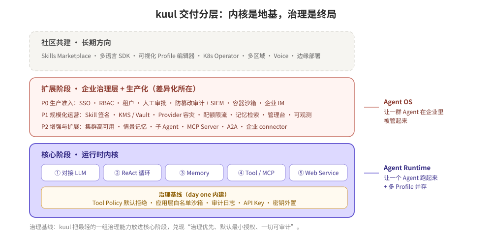
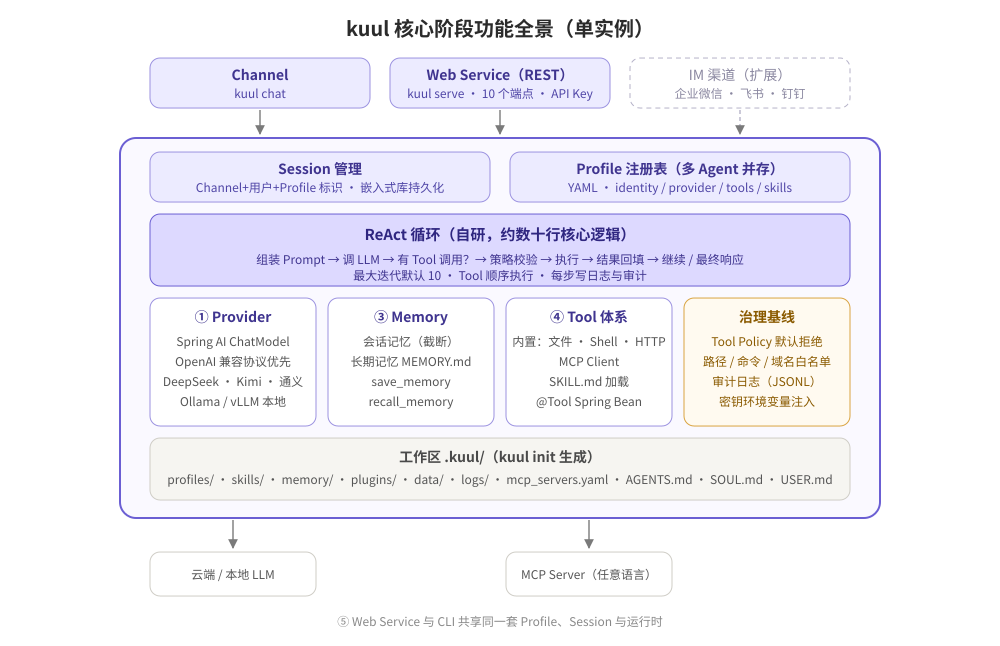
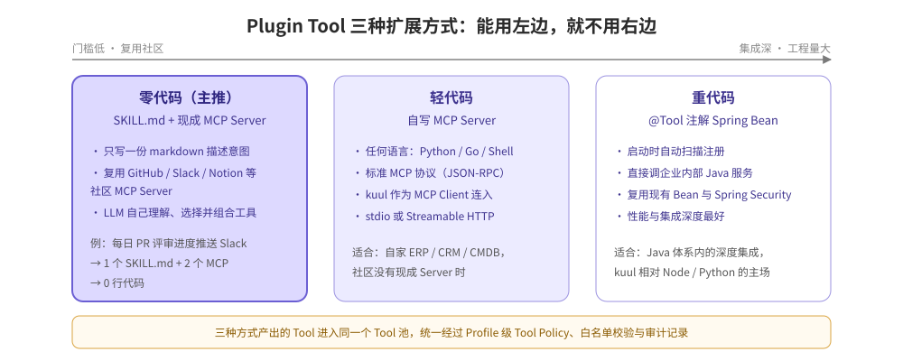

# kuul 需求分析

`v1.1` · `2026-11-21` · `内部讨论稿`

> 本文只回答 **What**：kuul 要做什么、做到什么程度算完成。**How** 留给技术方案。领域论证见 [ProductResearch.md](ProductResearch.md)。

**文档导航**：[产品调研](ProductResearch.md) → **需求分析** → [扩展分析](ExtensionAnalysis.md) → [技术方案](TechnicalSolution.md) → [AI 编程指南](AIProgrammingGuide.md)

<b>目录</b>

- [1. 定位与范围](#1-定位与范围)
- [2. 核心概念](#2-核心概念)
- [3. 核心功能](#3-核心功能)
- [4. 扩展与社区功能](#4-扩展与社区功能)
- [5. 非功能需求](#5-非功能需求)
- [6. 验收标准](#6-验收标准)
- [7. 风险与未决事项](#7-风险与未决事项)

---

## 1. 定位与范围

**kuul 是 Java 原生、私有部署、可审计的企业级 Agent 统一底座（Agent OS）。** 它本身就是一个 Spring Boot 应用，多个业务 Agent 跑在它上面，共享模型、工具、记忆、渠道和治理能力。业务方只做两件事：

- **配 Profile**：Agent 是配置出来的；
- **写 Tool**：任何语言，通过 MCP 接入。

kuul 的需求分三档：

| 档位 | 内容 | 说明 |
|---|---|---|
| **核心** | 运行时内核（五大能力）+ 治理基线 | 让 Agent 跑起来，并且多 Agent 可以并存 |
| **扩展** | 企业治理层、IM 渠道、集群 | kuul 区别于 OpenClaw / Hermes 的差异化所在 |
| **社区** | 生态与周边 | 开放给社区贡献 |

> [!IMPORTANT]
> **治理基线**：kuul 的原则是治理优先，所以 Tool Policy、审计日志、API 鉴权、密钥外置这几项不留到扩展阶段，**在核心阶段就具备**。

**不做**：

- 可视化 workflow 编排（Dify 一类平台可以作为客户端调用 kuul）；
- Agent 编程框架；
- 模型本身；
- SaaS 优先形态；
- 不受审批约束的自我进化。

**典型场景**（完整形态下的目标用法；核心阶段只验证其中的运行时链路）：

| 场景 | 链路 | 关键能力 |
|---|---|---|
| 运维自愈 | 告警经 Webhook 进入 → 拉取日志 → 匹配历史故障 → 执行自愈 Skill → 在 IM 群汇报 | Tool（SSH / Prometheus）、Memory、Skill |
| 合规知识助手 | 在飞书提问 → 检索合同和法规 → 给出带引用来源的建议 | 记忆检索准确度、引用可追溯 |
| 销售客户洞察 | 拜访前提问 → 调用 CRM 和企查查 MCP → 生成客户简报 | MCP 集成、Tool 编排 |

> [!NOTE]
> 客服、研发助手、数据分析等场景同理，都用 Profile + Plugin Tool + Web Service 组合实现，kuul 不为具体业务做专门模块。

---

## 2. 核心概念

| 概念 | 定义 |
|---|---|
| **Profile** | 一个 Agent 的完整 YAML 配置，一个 Profile 对应一个 Agent |
| **Provider** | LLM 的统一抽象，Agent 不感知底层是哪家厂商 |
| **ReAct 循环** | LLM 推理是否调用工具 → 执行 → 观察结果 → 继续，直到给出最终响应 |
| **Tool** | 内置 Tool 加上 Plugin Tool（SKILL.md + MCP、自写 MCP Server、`@Tool` Bean） |
| **Skill** | 用 `SKILL.md` 描述的指令模板，遵循 Agent Skills 开放标准（AAIF 托管），可以与 OpenClaw / Hermes 互通 |
| **Session** | 对话上下文容器，按 Channel + 用户 + Profile 区分 |
| **Channel** | 消息入口，如 CLI、IM。HTTP 接入归 Web Service |
| **Workspace** | 实例工作目录 `.kuul/`，包含 profiles、skills、memory、plugins、data、logs，以及 Bootstrap 文件 `AGENTS.md`、`SOUL.md`、`USER.md` |

---

## 3. 核心功能

### 3.1 能力一：对接 LLM

- 基于 Spring AI `ChatClient` 提供统一的 Provider 接口，Profile 按名称引用 Provider。
- **优先支持 OpenAI 兼容协议**，DeepSeek、Kimi 必须跑通。本地 Ollama / vLLM 走同一协议。
- 每次调用都记录 Provider、模型、Token 用量和延迟，作为成本透明的基础。

### 3.2 能力二：ReAct 循环

- 核心循环自己实现，不依赖框架自带的 Agent 抽象。
- 每轮 Prompt 由五部分组成：system prompt、Bootstrap、`MEMORY.md`、对话历史、可用 Tool。
- 最大迭代次数默认 10，可以在 Profile 里覆盖。
- 一次响应里有多个 Tool 调用时，按顺序执行。
- Tool 失败时按可重试标识重试（指数退避，最多 3 次），失败原因回传给 LLM。
- 每次 LLM 调用和 Tool 调用都写结构化日志，用 trace ID 串联。

### 3.3 能力三：Memory

| 层 | 核心阶段 | 扩展阶段 |
|---|---|---|
| 会话记忆 | Session 持久化；超出上下文窗口时截断早期对话 | 摘要压缩 |
| 长期记忆 | 单个 `MEMORY.md` 文件，启动时整体注入；内置 `save_memory` / `recall_memory`（关键词检索），何时记忆由 LLM 自行决定 | 自动抽取、向量检索、Memory Wiki |
| 情景记忆 | — | 记录任务过程中的决策与结果 |

### 3.4 能力四：Tool 体系

- **内置 Tool**：
  - 文件读写、列目录：受路径白名单约束；
  - Shell：受命令白名单和超时约束，不开放任意命令；
  - HTTP：受域名白名单约束；
  - 记忆读写。
- **Plugin Tool**，三种方式，能用前一种就不用后一种：
  - **零代码**：`skills/<name>/SKILL.md` 加上现成的 MCP Server；
  - **轻代码**：kuul 作为 MCP Client，接入自写的 MCP Server（stdio / Streamable HTTP），遵循 MCP 当前版规范；
  - **重代码**：用 `@Tool` 注解标注 Spring Bean，启动时自动扫描注册。

### 3.5 能力五：Web Service

REST API 是业务系统集成 kuul 的唯一通道。核心阶段同步返回，提供 10 个端点：

| 分类 | 端点 |
|---|---|
| 会话 | `POST /sessions` · `POST /sessions/{id}/messages` · `GET /sessions/{id}` · `DELETE /sessions/{id}` |
| 调用 | `POST /agents/{name}/invoke` |
| 查询 | `GET /profiles` · `GET /memory` · `GET /tools` |
| 系统 | `GET /health` · `GET /info` |

- 所有端点统一以 `/api/v1` 为前缀。
- 错误响应结构统一，包含错误码、错误信息和 trace ID。
- 支持的集成方式：
  - 同步调用 `invoke`，适合无状态短任务；
  - 先建会话再多轮发消息，保持上下文；
  - 告警、CI/CD、定时任务通过 HTTP 触发；
  - 任何能发 HTTP 请求的语言都能接入。

### 3.6 治理基线

| 项 | 要求 |
|---|---|
| **Tool Policy** | Profile 显式声明可用 Tool，**未声明即拒绝**；被拒绝的调用回传原因并记入审计 |
| **执行隔离** | 所有 Tool 都从统一入口做参数校验和白名单校验，并限制超时和资源占用。这里只做应用层隔离，不用 SecurityManager（JDK 24 起已禁用） |
| **审计日志** | JSONL 追加写入。每条记录谁、何时、通过哪个 Agent、调用了哪个模型或 Tool、结果如何；敏感字段脱敏 |
| **API 鉴权** | 除 `/health` 外，所有端点都要求 API Key |
| **密钥管理** | 密钥只通过环境变量或独立密钥文件注入，Profile 中禁止明文；加载时校验，缺失时明确报错 |

### 3.7 工作区、Profile 与运行入口

- **工作区**：`kuul init` 生成 `.kuul/` 目录结构、三个 Bootstrap 文件，以及一份开箱即用的默认 Profile（包含一个 Provider、基础 Tool 和 Channel）。
- **Profile 字段**：

  | 字段 | 内容 |
  |---|---|
  | `identity` | 名称、描述、人格 prompt（或引用 `SOUL.md`） |
  | `provider` | Provider 名、模型、参数 |
  | `tools` / `skills` | 可用 Tool 与引用的 Skill |
  | `policy` | Tool 授权规则 |
  | `channels` | 绑定的渠道 |
  | `bootstrap` | 要注入的 Bootstrap 文件 |
  | `settings` | 覆盖默认的 `max_iterations`、`max_history_turns` |

  加载时做 schema 校验，非法配置报出字段路径。
- **三种运行模式**，共享同一份 Profile 和 Session：
  - `kuul chat`：交互对话，或用 `--message` 发单条消息；
  - `kuul serve`：启动 HTTP 服务；
  - `kuul gateway`：常驻守护进程，扩展阶段用来承载多渠道。
- **CLI 命令**：
  - `init`：初始化工作区，不覆盖已有文件；
  - `status`；
  - `profile list | create | show | delete`；
  - `provider list` · `tool list` · `session list` · `audit tail`。
- **多 Agent**：多个 Profile 在同一实例并存。Session 持久化到嵌入式数据库，重启后可以恢复。
- **渠道**：核心阶段只提供终端交互 Channel。
- **项目主页**：用静态站点（如 VitePress）讲清 kuul 是什么、怎么快速开始，与 1.0 代码同期发布。

### 3.8 关键数据

| 实体 | 存储 | 用途 |
|---|---|---|
| Profile | `profiles/*.yaml` | Agent 定义 |
| Session | 嵌入式数据库 | 对话历史与上下文，状态为 active / archived |
| Memory | `memory/MEMORY.md` | 长期记忆，纯文本追加 |
| ToolInvocation | 嵌入式数据库 | 每次 Tool 调用的参数、状态（含 denied）、结果和耗时 |
| LlmCall | 嵌入式数据库 | 每次模型调用的 Provider、模型、Token 用量和延迟，是成本统计的依据 |
| AuditEvent | `logs/audit/*.jsonl` | 审计留痕 |

---

## 4. 扩展与社区功能

扩展功能的逐项分析（驱动因素、依赖、完成标准）见 [ExtensionAnalysis.md](ExtensionAnalysis.md)。这里只列概要：

| 优先级 | 定位 | 主要内容 |
|---|---|---|
| **P0** | 生产准入 | SSO + RBAC + 租户、人工审批节点、企业 IM 渠道、防篡改审计 + SIEM、容器级沙箱 |
| **P1** | 规模化运营 | Skill 签名、KMS / Vault、注入防御、Provider 容灾与流式、配额限流、记忆增强、Web Service 补全与定时任务、管理台与可观测、K8s 部署 |
| **P2** | 增强与扩展 | 集群高可用、情景记忆、子 Agent、自适应路由、MCP Server / A2A、企业 connector、Native Image |
| **社区** | 不排期 | Marketplace、多语言 SDK、可视化编辑器、Operator、Voice、边缘部署等 |

---

## 5. 非功能需求

| 类别 | 要求 |
|---|---|
| **性能** | 单节点支持 ≥ 10 个 Agent、≥ 100 个并发 Session；Session 创建 P99 < 200 ms；内部转发开销 < 50 ms（不含 LLM 耗时） |
| **可靠性** | 已写入的 Profile 和 Session 不丢失；Provider 故障直接上报，不自动容灾 |
| **安全** | 支持 HTTPS；核心阶段不建议用于高敏感生产场景 |
| **合规** | kuul 不主动外发任何数据；审计覆盖所有模型调用和 Tool 调用 |
| **可运维** | 支持物理机、虚拟机、Docker 部署（Kubernetes 放在扩展阶段）；新手 30 分钟内完成单节点部署 |
| **兼容性** | JDK 21+；主流 Linux 发行版；兼容 OpenAI 协议、MCP、Agent Skills 标准 |

---

## 6. 验收标准

**功能验收**：第 3 章的每项能力至少有一个端到端测试。

> [!WARNING]
> **场景验收**：以下 5 个 Demo 必须跑通，作为发布的硬条件。

| Demo | 验证内容 |
|---|---|
| 1 | Agent 调天气 API，再用文件 Tool 写日报（LLM + ReAct + 内置 Tool） |
| 2 | 第一次对话告知偏好，第二次对话能引用（Memory） |
| 3 | 通过 SKILL.md + 外部 MCP Server 完成跨工具任务（Plugin Tool） |
| 4 | 外部系统通过 REST 完成"创建会话 → 发消息 → 归档"（Web Service） |
| 5 | 未授权的 Tool 调用和无效 API Key 都被拒绝，并能在审计日志中查到（治理基线） |

**性能验收**：按第 5 章的指标压测，并验证 10 个 Agent 稳定运行 4 小时。未达标的项进入扩展阶段优化，不阻塞发布。

**可运维验收**：新手 30 分钟内完成单节点部署；CLI 的帮助和错误提示清晰；项目主页可访问。

---

## 7. 风险与未决事项

| 风险 | 应对 |
|---|---|
| **Spring 版本线分裂**：Spring AI 2.x 面向 Spring Boot 4，Spring AI Alibaba 仍在 1.x 线 | 以 OpenAI 兼容协议为主路径，降低对 Spring AI Alibaba 的依赖 |
| **各家 Provider 在 Function Calling、Token 计数上行为不一致** | 先把兼容协议跑稳，每新增一家 Provider 做一次回归 |
| **应用层白名单不等于真隔离** | 收窄内置 Tool 能力；对外明确核心阶段不适合高敏感生产场景 |
| **Java 启动慢、内存占用大**，削弱"装好就跑"的体验 | 先用标准 JVM 验证功能，再评估 GraalVM Native Image |
| **扩展功能依赖社区接力**，可能长期没人推进 | 项目方保底投入 P0 项；社区项即使没人做也不影响主线 |
| **被误读为"又一个 OpenClaw"** | 统一口径：核心阶段是 Java 原生运行时加治理基线，差异化在扩展阶段的治理层 |

**待技术方案决议**（决议结果见 [TechnicalSolution.md](TechnicalSolution.md) 1.3）：

1. Spring 版本线选哪条：Boot 4 + Spring AI 2.x，或 Boot 3.5 + Spring AI 1.x + Spring AI Alibaba。
2. Provider 层是否在 `ChatClient` 之上再加一层 kuul 自己的抽象。
3. 嵌入式数据库选 SQLite 还是 H2。
4. Bootstrap 文件与 `MEMORY.md` 的注入顺序。
5. Tool Policy 的表达力：只做 allow-list，还是支持参数级约束。
