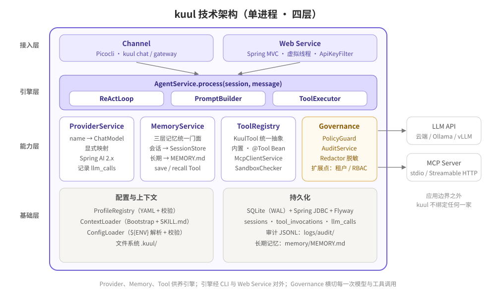
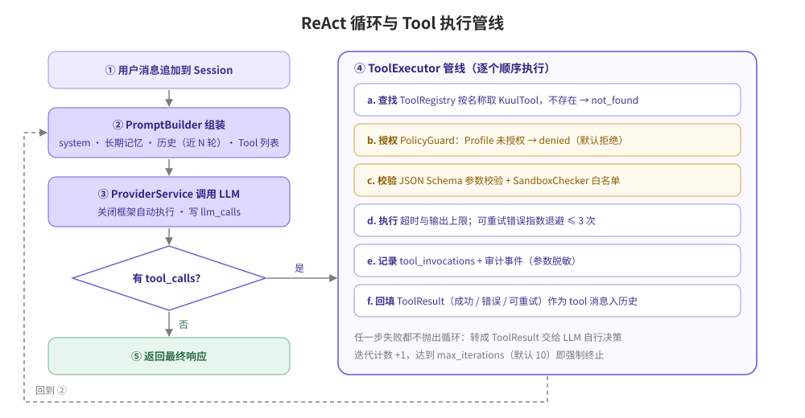
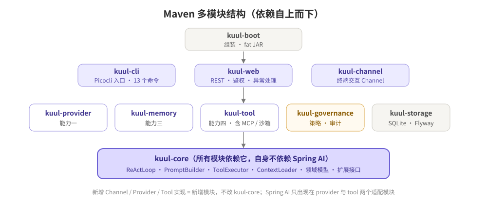

# kuul 技术方案

`v1.0` · `2026-11-21` · `内部讨论稿`

> 本文回答 **How**，只覆盖核心阶段，并为扩展阶段的治理层预留扩展点。
>
> 前置文档：
> - [ProductResearch.md](ProductResearch.md)：领域判断；
> - [RequirementAnalysis.md](RequirementAnalysis.md)：功能边界。
>
> 每个模块只写职责、关键设计和取舍，代码细节在研发阶段补充。

**文档导航**：[产品调研](ProductResearch.md) → [需求分析](RequirementAnalysis.md) → [扩展分析](ExtensionAnalysis.md) → **技术方案** → [AI 编程指南](AIProgrammingGuide.md)

<details>
<summary><b>目录</b></summary>

- [1. 方案概述](#1-方案概述)
- [2. 整体架构](#2-整体架构)
- [3. 能力一：对接 LLM](#3-能力一对接-llm)
- [4. 能力二：ReAct 循环](#4-能力二react-循环)
- [5. 能力三：Memory](#5-能力三memory)
- [6. 能力四：Tool 体系](#6-能力四tool-体系)
- [7. 能力五：Web Service](#7-能力五web-service)
- [8. 治理基线](#8-治理基线)
- [9. 支撑模块](#9-支撑模块)
- [10. 数据持久化](#10-数据持久化)
- [11. 工程结构](#11-工程结构)
- [12. 关键流程](#12-关键流程)
- [13. 性能、测试与扩展点](#13-性能测试与扩展点)
- [14. 技术风险](#14-技术风险)

</details>

---

## 1. 方案概述

**kuul 是一个 Spring Boot 单体应用，打包成一个可执行 JAR。** 它有以下几个特点：

- 自己实现 ReAct 循环，作为引擎；
- Spring AI 只用来做协议适配；
- Tool Policy 和审计从第一天就内建在 Tool 执行管线里。

### 1.1 技术栈

| 层面 | 选型 |
|---|---|
| 运行时 | JDK 21+（推荐 25 LTS），使用虚拟线程 |
| 应用框架 | Spring Boot 4.0.x |
| LLM 接入 | Spring AI 2.x：`ChatModel`、`@Tool` Schema 生成；国产模型走 OpenAI 兼容协议 |
| MCP | 官方 MCP Java SDK（Client 端），支持 stdio 和 Streamable HTTP |
| HTTP 服务 | Spring MVC + 虚拟线程 |
| 命令行 | Picocli |
| 配置解析 | Jackson YAML + JSON Schema 校验 |
| 持久化 | SQLite（xerial sqlite-jdbc）+ Spring JDBC（`JdbcClient`）+ Flyway |
| 日志 | SLF4J + Logback，JSON 输出，`trace_id` 放在 MDC 中 |
| 测试 | JUnit 5、WireMock（模拟 LLM 和 HTTP）、脚本化的模拟 Provider |

### 1.2 关键技术决策

| # | 决策 | 选择 | 理由 |
|---|---|---|---|
| D1 | Agent 引擎 | 自己实现 ReAct 循环，不用框架的 Agent 抽象 | 核心可控，循环行为可以定制 |
| D2 | Spring AI 的使用边界 | 只用它做 Provider 协议转换和 `@Tool` 的 JSON Schema 生成；**关闭它的内部工具执行**（`internalToolExecutionEnabled=false`） | 否则 Tool 会被执行两次，还会绕过 kuul 的策略和审计 |
| D3 | 版本线 | Spring Boot 4 + Spring AI 2.x；Spring AI Alibaba 不作为硬依赖 | 跟主线走，MCP 支持更完整。国产模型基本都兼容 OpenAI 协议 |
| D4 | 执行模型 | 同步阻塞 + 虚拟线程 | 代码直观，单机能扛住几千个并发 IO 等待，不需要响应式编程 |
| D5 | Tool 抽象 | 统一用 `KuulTool` 接口，内置 Tool、`@Tool` Bean、MCP Tool 都包装成它 | 引擎不需要知道 Tool 从哪来，治理逻辑只写一处 |
| D6 | 治理 | Tool Policy 校验和审计记录是执行管线中的固定步骤 | 每次调用都必然经过，不靠调用方自觉 |
| D7 | 沙箱 | 应用层白名单，并加固防绕过；不用 SecurityManager | SecurityManager 从 JDK 24 起永久禁用 |
| D8 | 持久化 | SQLite + JDBC + Flyway；长期记忆用 `MEMORY.md` 文件 | 单文件、零运维；SQLite 的 `ALTER TABLE` 能力弱，要用迁移脚本管理表结构 |
| D9 | 进程形态 | 单进程 fat JAR；CLI 命令分轻、重两类 | "装好就跑"；轻命令不启动 Spring，启动快 |

### 1.3 需求未决事项的决议

| 未决事项 | 决议 | 理由 |
|---|---|---|
| Spring 版本线 | Boot 4 + Spring AI 2.x | 见 D3 |
| Provider 抽象层次 | 定义 kuul 自己的 `ProviderService` 接口，Spring AI 的 `ChatModel` 只作为它的一种实现 | Spring AI 的类型不会渗透进 `kuul-core`，以后可以换成 AgentScope 等实现 |
| 嵌入式数据库 | SQLite | 单文件，任何语言的工具都能读；WAL 模式支持读写并发 |
| Bootstrap 注入顺序 | identity prompt（默认就是 `SOUL.md`）→ `AGENTS.md` → `USER.md` → Skills → `MEMORY.md` | 先确定身份和规则，再加入偏好和技能；把最易变的长期记忆放在最后，紧挨对话历史 |
| Tool Policy 表达力 | 核心阶段：allow-list，再加上 Profile 级的资源白名单收窄；deny 规则和参数级约束放扩展阶段 | 先用最简单的形式落地"默认拒绝" |

---

## 2. 整体架构



kuul 分四层，每层的职责如下：

| 层 | 组件 | 职责 |
|---|---|---|
| 接入层 | Channel、Web Service | 消息进出。两个入口最后都调用 `AgentService.process` |
| 引擎层 | `ReActLoop`、`PromptBuilder`、`ToolExecutor` | Agent 的大脑。自己不干具体的活，负责调度能力层 |
| 能力层 | Provider、Memory、Tool、Governance | 前三者提供推理、上下文和执行能力；Governance 横切每一次模型调用和工具调用 |
| 基础层 | Profile、上下文加载、配置、持久化 | 工程地基 |

两条架构原则：

1. **收敛**：所有能力都在一个进程、一套存储里。LLM 和 MCP Server 在应用边界之外，kuul 不绑定任何一家。
2. **解耦**：引擎和能力、能力和外部之间都只通过接口交互。新增 Channel、Provider 或 Tool 时只在边缘加实现，不改引擎。

---

## 3. 能力一：对接 LLM

### 3.1 Provider 配置与显式映射

Provider 在 `.kuul/kuul.yaml` 中声明：

```yaml
providers:
  deepseek:
    type: openai-compatible
    base_url: https://api.deepseek.com
    api_key: ${DEEPSEEK_API_KEY}
    model: deepseek-chat
  kimi:
    type: openai-compatible
    base_url: https://api.moonshot.cn/v1
    api_key: ${MOONSHOT_API_KEY}
    model: kimi-k2
  local:
    type: openai-compatible
    base_url: http://localhost:11434/v1
    model: qwen3
```

- `ProviderRegistry` 在启动时，按每一条配置**用代码直接创建** `ChatModel` 实例，建立"名称 → 实例"的映射表。
- 不靠扫描 Spring 容器里的 Bean。原因是：配置多个 Provider 时，容器里会有多个同类型的 Bean，Bean 名称也不一定等于 Provider 名称，扫描无法可靠区分。
- `type` 首批支持 `openai-compatible` 和 `anthropic`，其他类型按需扩展。

### 3.2 ProviderService

- **接口**：`chat(ProviderRequest) → ProviderResponse`。
  - 请求：消息列表、Tool 定义、参数；
  - 响应：文本、`tool_calls`、Token 用量。
  - 这些类型都是 `kuul-core` 自己的领域模型，由适配层负责和 Spring AI 的类型互相转换。
- **每次调用都写一条 `llm_calls` 记录**：Provider、模型、Token、延迟、状态。
- **故障处理**：
  - 失败统一包装成 `ProviderException`，对外返回 503；
  - 核心阶段不做 fallback，但 Profile 中预留了 `provider.fallback` 字段。

---

## 4. 能力二：ReAct 循环



### 4.1 引擎组件

| 组件 | 职责 |
|---|---|
| `AgentService` | 统一入口，接收 `AgentRequest(profile, sessionId, message)`，返回 `AgentResponse(content, iterations, toolCalls, traceId, stopReason)`。请求带了 `sessionId` 就直接用；没带（CLI 场景）就按 `(channel, user, profile)` 查找活跃 Session，找不到再新建 |
| `ReActLoop` | 核心循环，几十行代码。负责迭代计数、截止时间检查、消息累积 |
| `PromptBuilder` | 按 1.3 的顺序拼出 system 部分，再加上近 N 轮对话历史和当前 Profile 可用的 Tool 定义 |
| `ToolExecutor` | 按图中 a–f 六步执行 Tool 调用。`retryable` 错误按指数退避最多重试 3 次；任何异常都转成 `ToolResult`，不让异常抛出循环 |

循环步骤（与图对应）：

1. 用户消息追加到 Session；
2. 组装 Prompt；
3. 调用 LLM；
4. 没有 `tool_calls` 就返回最终响应；
5. 有 `tool_calls` 就逐个走 Tool 管线，结果作为 tool 消息回填；
6. 回到第 2 步。

### 4.2 关键设计

- **终止条件**：
  - 给出最终响应；
  - 达到 `max_iterations`（默认 10）；
  - 超过整体截止时间（默认 60 秒）；
  - Provider 故障。

  终止原因写入 `stopReason`。
- **消息累积**：assistant 的 `tool_calls` 和对应的 tool 结果都完整写入 Session，调用链可以回放、可以审计。
- **上下文窗口**：保留 system 部分，加上最近 `max_history_turns` 轮（默认 20）；超出的部分直接丢弃，扩展阶段改为摘要压缩。
- **会话互斥**：同一个 Session 同一时间只处理一条消息（会话级锁）。并发请求返回 409。
- **会话生命周期**：
  - 活跃 Session 的每条消息都实时落库，重启后从 SQLite 恢复；
  - 后台定时任务把空闲超过 `session.idle_timeout`（默认 30 分钟）的 Session 标记为 archived，归档后仍可查询。
- **Tool 输出不可信**：Tool 结果用固定的分隔标记包裹后才回填，防止工具输出里夹带的指令被当成系统指令。
- **核心阶段不做**：并行 Tool 调用、子 Agent 委托、流式输出。

---

## 5. 能力三：Memory

`MemoryService` 是三层记忆的**统一门面**。引擎只调用 `context(session)` 一个接口，就能拿到会话历史和长期记忆。

| 子模块 | 实现 |
|---|---|
| 会话记忆 | 委托给 `SessionStore`（SQLite） |
| `LongTermMemory` | 操作 `.kuul/memory/MEMORY.md`，提供四个方法：`append`（自动加日期标题，加文件锁）、`load`（超过 4000 字时只保留最近的内容）、`recall(query, mode)`（核心阶段只支持 `keyword` 模式，接口已为 `semantic` 预留）、`truncateIfNeeded` |
| `MemoryTools` | 把 `save_memory` / `recall_memory` 作为内置 Tool 注册，和其他 Tool 一样走同一条管线 |

- **不缓存**：每轮都重新读 `MEMORY.md`。这样 `save_memory` 写入后，下一轮马上可见。文件只有几 KB，读一次约 1–2 毫秒。扩展阶段再加内存缓存，并监听文件变更使缓存失效。
- **文件格式**：Markdown 列表，每条记忆带日期标题，不强制结构，由 LLM 自己理解。
- **`USER.md` 与 `MEMORY.md` 的区别**：

  | 文件 | 谁来写 | kuul 的权限 | 定位 |
  |---|---|---|---|
  | `USER.md` | 用户手写 | 只读 | 初始设定 |
  | `MEMORY.md` | Agent 写入 | 读写 | 成长记录 |

---

## 6. 能力四：Tool 体系

### 6.1 KuulTool 抽象

```text
KuulTool { name, description, inputSchema(JSON Schema), risk(LOW|HIGH), execute(input, ToolContext) → ToolResult }
ToolResult { ok, content, error, retryable }
```

`ToolRegistry` 是全局的 Tool 池。每个 Profile 看到的可用 Tool，是全局池与它的 Policy 的交集。

### 6.2 三类来源

| 来源 | 注册方式 | 说明 |
|---|---|---|
| 内置 Tool | `kuul-tool` 模块里的 `@Tool` 方法 | 包括 `read_file` / `write_file` / `list_dir`、`shell`、`http_get` / `http_post`、`save_memory` / `recall_memory`。其中 `shell`、`write_file`、`http_post` 标记为高风险（HIGH） |
| `@Tool` Bean（重代码） | 业务方把 JAR 放进 `.kuul/plugins/`，通过 Spring Boot `PropertiesLauncher` 的 `loader.path` 加载，再扫描注册 | 进程内直接调用，性能最好，可以复用企业现有的 Java 服务 |
| MCP Tool（轻代码 / 零代码） | `McpClientService` 读取 `mcp_servers.yaml`，连接每个 Server，调用 `tools/list`，把每个工具包装成 `KuulTool` | 工具名带命名空间：`<server>.<tool>`，避免重名 |

`mcp_servers.yaml` 示例：

```yaml
github:
  transport: stdio
  command: npx
  args: [-y, "@modelcontextprotocol/server-github"]
  env:
    GITHUB_TOKEN: ${GITHUB_TOKEN}
crm:
  transport: http
  url: https://crm.internal/mcp
  headers:
    Authorization: "Bearer ${CRM_TOKEN}"
```

- **Server 不可用**：在日志里标记，并在后台按退避策略重连。不阻断启动，这个 Server 的工具暂时不注册。
- **SKILL.md 不是 Tool**：它本质上是 prompt 的输入，所以由 `ContextLoader` 负责加载（见 9.2），不放在 Tool 模块。
  - frontmatter 遵循 Agent Skills 标准（`name`、`description`）；
  - Skill 里用到的工具，仍然要在 Profile 中显式授权。

### 6.3 沙箱加固（SandboxChecker）

> [!IMPORTANT]
> 白名单配置在 `kuul.yaml` 的 `sandbox` 段，是全局上限。Profile 只能在此基础上收窄，不能放宽。

| 类型 | 校验 |
|---|---|
| 文件 | 先标准化路径，再用 `toRealPath` 解析符号链接，结果必须落在允许的根目录内，防止 `../` 和符号链接逃逸；单个文件有大小上限 |
| Shell | **不经过 `bash -c`**，用 `ProcessBuilder` 按参数数组直接执行；第一个参数必须在命令白名单内；拒绝 `; \| & $( ` 和重定向等元字符；有超时，输出上限 64KB |
| HTTP | 只允许 http / https；主机名按通配符匹配白名单；**手动跟随重定向**，每一跳都重新校验；响应体有大小上限 |

---

## 7. 能力五：Web Service

| 组件 | 职责 |
|---|---|
| `WebServer` | `kuul serve` 启动，默认端口 8080，开启虚拟线程（`spring.threads.virtual.enabled=true`） |
| 6 个 Controller | Session、Agent、Profile、Memory、Tool、System。只负责参数校验和响应包装，业务逻辑委托给 `AgentService` 等服务 |
| `ApiKeyFilter` | 校验 `Authorization: Bearer <key>`。Key 从环境变量 `KUUL_API_KEYS` 读取，用常量时间比较；`/health` 免鉴权。扩展阶段可以直接换成 Spring Security 的过滤器链 |
| `GlobalExceptionHandler` | 统一返回 `{code, message, traceId, timestamp}` |
| 系统端点 | `/health` 检查数据库和各 Provider 的连通性（结果缓存 30 秒），任何一项不可用都返回 503；`/info` 返回版本、已加载的 Profile 数量、MCP Server 的连接状态 |

状态码与约束：

| 项 | 约定 |
|---|---|
| 状态码 | 400 参数错误 · 401 未鉴权 · 404 资源不存在 · 409 会话正忙 · 500 内部错误 · 503 Provider 故障 · 504 超时 |
| 请求与返回上限 | 单条消息最大 32KB；查询会话历史时最多返回最近 100 条 |
| 超时 | 每次 Agent 调用最长 60 秒 |
| CORS | 默认关闭，需要时通过配置开放 |

---

## 8. 治理基线

| 组件 | 实现 |
|---|---|
| `PolicyGuard` | 位于 Tool 管线第 b 步。Profile 的 `tools` 列表就是 allow-list，支持 `github.*` 这样的命名空间通配；高风险 Tool 不能通过通配符授权，必须单独列出 |
| `AuditService` | 接收 `AuditEvent`，交给 `AuditSink` 写出。核心阶段的实现是 `JsonlAuditSink`：按天追加写入 `logs/audit/audit-YYYY-MM-DD.jsonl` |
| `Redactor` | 先脱敏再落盘：`api_key`、`token`、`password` 等字段打码，过长的参数截断 |
| `ConfigLoader` | 解析 `${ENV}` 占位符，校验必填项。缺失时报出"文件 + 字段路径 + 环境变量名"；如果 Profile 里出现明文密钥，直接拒绝加载 |

`AuditEvent` 的字段：

| 字段 | 含义 |
|---|---|
| `trace_id` · `timestamp` | 串联同一次请求的链路，记录发生时间 |
| `actor` | CLI 调用记操作系统用户，API 调用记 API Key 的 ID |
| `tenant_id` | 核心阶段固定为 `default`，为多租户预留 |
| `profile` · `action` · `target` | 哪个 Agent、做了什么、对象是谁 |
| `summary` · `outcome` | 脱敏后的参数摘要、结果状态 |

`action` 取值：`llm_call`、`tool_call`、`policy_denied`、`api_access`。

> [!NOTE]
> 审计数据分两处存：JSONL 是只追加的审计流水；`tool_invocations` 和 `llm_calls` 两张表是可以查询的业务记录。两者通过 `trace_id` 关联。

---

## 9. 支撑模块

### 9.1 工作区与 Profile

```text
.kuul/
├── kuul.yaml            # Provider、沙箱、服务端口
├── mcp_servers.yaml
├── AGENTS.md  SOUL.md  USER.md
├── profiles/default.yaml
├── skills/<name>/SKILL.md
├── memory/MEMORY.md
├── plugins/             # @Tool Bean 的 JAR
├── data/kuul.db
└── logs/{app,audit}/
```

`kuul init` 会做以下几件事：

- 创建上面的目录结构；
- 写入 Bootstrap 和 `kuul.yaml` 模板；
- 生成 `default.yaml`；
- 初始化数据库。

已存在的文件不覆盖，会跳过并给出提示。`kuul profile create <name>` 从同一份模板生成新的 Profile。

Profile 示例：

```yaml
name: ops-assistant
identity:
  agent_name: 运维助手
  prompt_file: SOUL.md
provider:
  name: deepseek
  temperature: 0.2
tools: [read_file, http_get, shell, save_memory, recall_memory, github.*]
skills: [daily-pr-digest]
policy:
  file:
    allowed_paths: [./workspace]
  shell:
    allowed_commands: [kubectl, git]
bootstrap: [AGENTS.md, SOUL.md, USER.md]
settings:
  max_iterations: 10
  max_history_turns: 20
```

- **`ProfileLoader`**：用 JSON Schema 校验 Profile，并检查 Provider、Tool、Bootstrap 文件是否存在。校验失败的 Profile 不会阻断启动，但不会被注册，同时记录错误。
- **`ProfileRegistry`**：按名称索引所有 Profile，支持多个 Profile 并存。

### 9.2 上下文加载

`ContextLoader` 统一加载 Bootstrap 文件和 SKILL.md。这两类内容本质相同，都是注入 system prompt 的 Markdown。每次组装 Prompt 时都重新读取，用户修改后立即生效。

### 9.3 CLI 与运行模式

| 类别 | 命令 | 启动方式 |
|---|---|---|
| 轻命令 | `init`、`profile *`、`session list`、`audit tail` | 不启动 Spring，直接读写文件或用 JDBC，亚秒级完成 |
| 重命令 | `chat`、`serve`、`gateway`、`status`、`provider list`、`tool list` | 启动 Spring 上下文，需要初始化 Provider 和 MCP 连接 |

三种运行模式只是接入层不同，共享同一套引擎和存储：

- `chat`：读标准输入、写标准输出，支持 `/quit`；
- `gateway`：核心阶段等同于 `serve` 常驻运行，扩展阶段在这里挂载 IM Channel。

---

## 10. 数据持久化

- **数据库文件**：`.kuul/data/kuul.db`。
- **连接设置**：开启 `journal_mode=WAL` 和 `busy_timeout`。
- **写入方式**：所有写操作经过一个**单线程写执行器**串行执行，避免 SQLite 的写锁冲突；读操作可以并发。
- **表结构管理**：用 Flyway 维护 `V1__init.sql` 等迁移脚本，不依赖自动建表。

| 表 | 关键字段 |
|---|---|
| `sessions` | `session_id`（UUID）、`profile_name`、`channel`、`user_id`、`tenant_id`、`messages_json`、`context_json`、`status`、`created_at` / `last_active_at` / `archived_at`；在 `(channel, user_id, profile_name)` 上对 active 状态建唯一索引 |
| `tool_invocations` | `invocation_id`、`session_id`、`trace_id`、`tool_name`、`params_json`（脱敏）、`status`（completed / failed / timeout / denied）、`result` / `error`、`duration_ms` |
| `llm_calls` | `call_id`、`session_id`、`trace_id`、`provider`、`model`、`prompt_tokens` / `completion_tokens`、`latency_ms`、`status` |

**文件系统数据**：Profile、Bootstrap、Skill、`MEMORY.md`、MCP 配置都放在文件里，方便直接编辑、用 git 跟踪和备份。

> [!IMPORTANT]
> **核心阶段不引入向量库**：主流向量库（Qdrant、Milvus、pgvector 等）都需要单独部署一个进程，和单进程"装好就跑"的定位冲突。关键词检索已经够跑通最短链路。

**向量检索的升级路径**（扩展阶段二选一）：

| 方案 | 优点 | 代价 |
|---|---|---|
| pgvector | 最成熟 | 需要额外部署一个 PostgreSQL |
| JVector 等纯 Java 嵌入式索引 | 保持单进程部署 | 成熟度有待验证 |

`LongTermMemory.recall(mode)` 已为语义检索预留接口，切换底层实现不影响上层。

---

## 11. 工程结构



| 模块 | 职责 |
|---|---|
| `kuul-core` | 引擎（ReActLoop、PromptBuilder、ToolExecutor、ContextLoader）、领域模型，以及 `KuulTool`、`ProviderService`、`AuditSink` 等接口。**不依赖 Spring AI** |
| `kuul-provider` | `ProviderRegistry`、Spring AI 适配、`llm_calls` 记录 |
| `kuul-memory` | `MemoryService`、`LongTermMemory`、`MemoryTools` |
| `kuul-tool` | 内置 Tool、`ToolRegistry`、MCP Client、`SandboxChecker` |
| `kuul-governance` | `PolicyGuard`、`AuditService`、`Redactor`、`ConfigLoader` |
| `kuul-storage` | SQLite、Flyway、各类 Store 实现 |
| `kuul-web` | Controller、`ApiKeyFilter`、异常处理 |
| `kuul-channel` | 终端交互 Channel |
| `kuul-cli` | Picocli 入口，13 个命令 |
| `kuul-boot` | 组装所有模块，打包成 fat JAR |

构建与启动：`mvn package` 生成 `kuul.jar`，再用 `java -jar kuul.jar <command>` 运行。

项目主页放在独立目录 `site/`（VitePress），不进入 Maven 构建。

---

## 12. 关键流程

5 个验收 Demo 依次经过的模块如下。它们同时也是端到端测试的骨架。

| Demo | 模块链路 |
|---|---|
| 1. 查天气写日报 | CliChannel → AgentService → PromptBuilder（ContextLoader + MemoryService）→ ProviderService 返回 `http_get` → ToolExecutor（PolicyGuard、SandboxChecker 校验域名）→ 结果回填 → 第二轮调 `write_file` → 返回最终响应 |
| 2. 跨对话记偏好 | 第一次对话：LLM 调 `save_memory` → `LongTermMemory.append`。第二次对话（可以在重启之后）：`MemoryService` 把 `MEMORY.md` 注入 system → LLM 直接用上偏好 |
| 3. Skill + MCP | 启动时 McpClientService 连接 github、slack 并注册 `github.*`、`slack.*`；ContextLoader 注入 SKILL.md → LLM 先调 `github.list_pull_requests` 再调 `slack.post_message`，每一步都经过 Policy 校验和审计 |
| 4. REST 会话 | `POST /sessions` → `POST /sessions/{id}/messages`（ApiKeyFilter → AgentService 跑完整循环）→ `GET` 查历史 → `DELETE` 归档 |
| 5. 多端点联动 + 治理 | 依次调用 `/info`、`/profiles`、`/tools`、`/memory`、`/agents/{name}/invoke`；Key 无效时返回 401，未授权的 Tool 调用返回 denied，两者都能在 `audit tail` 中查到 |

---

## 13. 性能、测试与扩展点

### 13.1 性能

| 指标 | 怎么达到 |
|---|---|
| ≥ 100 个并发 Session | 每个请求跑在独立的虚拟线程上，等待 LLM 时自动让出系统线程；1000 个 Session 每个约 50KB，总共约 50MB 内存 |
| Session 创建 P99 < 200 ms | SQLite WAL + 单写线程；压测发现瓶颈时，再把消息追加改成批量落盘 |
| 内部转发开销 < 50 ms | 不加缓存层，热路径上只有一次 SQLite 读、一次 `MEMORY.md` 读 |
| 启动 | 常驻服务启动 2–4 秒可以接受；CLI 靠轻命令分流；扩展阶段评估 GraalVM Native Image |

### 13.2 测试策略

- **单元测试**：用**脚本化的模拟 Provider** 按预设顺序返回 `tool_calls` 和最终响应，确定性地覆盖 ReAct 循环的各种分支（终止、重试、拒绝、超时）。
- **集成测试**：
  - 用 WireMock 模拟 OpenAI 兼容接口和外部 HTTP 服务；
  - 用一个本地 stdio MCP 测试 Server 验证 MCP 链路。
- **端到端测试**：需求分析第 6 章的 5 个 Demo 各对应一个 E2E 用例。只有 DeepSeek 和 Kimi 的真实 Key 冒烟测试单独执行。

### 13.3 为扩展阶段预留的扩展点

| 扩展能力 | 预留位置 |
|---|---|
| 多租户 | `sessions` 表和 `AuditEvent` 已有 `tenant_id` 字段 |
| SSO / RBAC | 把 `ApiKeyFilter` 替换为 Spring Security 过滤器链；`actor` 改为记录真实身份 |
| 人工审批 | 在 Tool 管线的 b 步和 d 步之间插入 `ApprovalGate`（高风险 Tool 暂停执行，等待审批） |
| 容器沙箱 | 新增 `ToolRunner` 接口，从进程内执行切换为子进程或 Docker |
| SIEM / 防篡改 | 新增 `AuditSink` 实现；JSONL 加链式哈希 |
| IM 渠道 | 实现 `Channel` 接口，复用 `AgentService` |
| 流式输出 | `AgentService` 改为返回事件流，用 `SseEmitter` 输出 |
| Provider 容灾 | 启用 Profile 中的 `provider.fallback` 字段，加熔断 |
| 可观测 | 引入 Micrometer + Prometheus 指标；OpenTelemetry 追踪复用现有的 `trace_id` |
| 限流 | 在 Web 层按 API Key 限流 |

---

## 14. 技术风险

| 风险 | 应对 |
|---|---|
| Spring AI 2.x 的 API 还在演进 | Spring AI 只出现在 `kuul-provider` 和 `kuul-tool` 两个适配模块；升级时只改适配层 |
| 各家模型的 Function Calling 行为不一致 | 每个 Provider 都必须通过同一套 ReAct 契约测试，才算支持 |
| SQLite 写竞争 | 单写线程 + WAL；压测验证 100 个并发 Session |
| MCP 规范和 SDK 在变化 | MCP 相关代码收敛在 `McpClientService`；以 2026-07-28 版规范为基线 |
| 通过 Tool 输出进行提示注入 | Tool 输出用分隔标记包裹；默认拒绝 + 白名单限制破坏范围；高风险 Tool 必须显式授权 |
| 应用层沙箱不是真正的隔离 | 采用 6.3 的加固措施；对外声明核心阶段不适合高敏感生产场景 |
